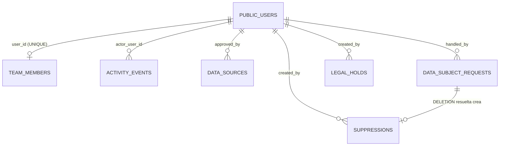

# Growth Suite — Plan técnico de la Fase 0 (Fundamentos)

> Estado: **pendiente de aprobación**. Nada de este plan se ha ejecutado.
> Diseño de referencia: `docs/superpowers/specs/2026-10-30-growth-suite-design.md`.
> Base: `origin/main` @ `58ef108` (0.33.0). Inspeccionado sobre `origin/main`, no sobre `feat/plan-piloto`.

## 0. Decisiones aprobadas (2026-10-30)

1. Módulo interno `src/modules/growth` + esquema PostgreSQL `growth`. Sin microservicio; extraíble más adelante.
2. Lo usa primero el administrador principal, pero desde el día uno se diseña para un equipo: usuarios comerciales, roles, asignación con historial y registro de actividad por usuario.
3. Fuentes: RUES y registros empresariales legales, sitios corporativos, directorios públicos, información suministrada, investigación manual y fuentes sectoriales autorizadas. Google Places **solo con aprobación previa de costo**. Sin scraping de LinkedIn ni extracción indiscriminada. **Cero gasto automático.**
4. Retención: revisión a los 12 meses desde la última interacción o verificación (no es autorización para conservar indefinidamente), supresión, lista de exclusión mínima, anonimización y excepciones legales.
5. `GROWTH_ENABLED=false` por defecto. Sin cambios funcionales en producción hasta autorizar la activación.

---

## 1. Alcance de la Fase 0

**Incluye:** esquema `growth`, equipo comercial, registro de actividad, catálogo de fuentes, primitivas legales (lista de exclusión, solicitudes de titulares, retenciones legales), roles y permisos, bandera, reglas de aislamiento y pruebas.

**No incluye:** prospectos (cuentas, contactos, copropiedades), evidencias, deduplicación, importación, pantallas web, colas, APIs externas. Todo eso es de la Fase 1.

**Por qué la asignación de prospectos no crea tabla en la Fase 0:** su historial necesita una FK real hacia `growth.accounts`, que nace en la Fase 1. Crear hoy una tabla polimórfica (`entity_type` + `entity_id`, sin FK) sacrificaría integridad. Su diseño ya queda fijado (§3.7) y se crea junto con `accounts`.

---

## 2. Estado de Git y creación segura de la rama

### Estado actual (verificado)

| Elemento | Estado |
|---|---|
| Rama actual | `feat/plan-piloto`, al día con `origin/feat/plan-piloto` |
| `feat/plan-piloto` vs `origin/main` | 2 commits propios (`ac46106`, `54b18ae`) que ya entraron a main por PR; main va 7 commits adelante (0.33.0) |
| `src/schema.gql` | modificado **solo en finales de línea** (`git diff` sin cambios de contenido) |
| `docs/superpowers/specs/2026-10-30-growth-suite-design.md` | sin versionar |
| `docs/superpowers/plans/2026-10-30-growth-suite-fase-0.md` (este archivo) | sin versionar |
| `handOff.md` | sin versionar a propósito (nunca se sube) |
| Stashes | 3 antiguos, ajenos; no se tocan |
| Worktrees | `-iot` activo; `-avisos` y `-mascotas` marcados como `prunable` |

### Procedimiento propuesto (no ejecutado)

Los archivos sin versionar no se pierden al cambiar de rama, pero `git switch` se negaría por `src/schema.gql`. Descartar ese cambio fue bloqueado antes. Por eso se propone **no tocar este directorio** y trabajar en un worktree:

```bash
# 1. Respaldo de los dos documentos fuera del repo (por si acaso)
cp docs/superpowers/specs/2026-10-30-growth-suite-design.md  <scratchpad>/
cp docs/superpowers/plans/2026-10-30-growth-suite-fase-0.md  <scratchpad>/

# 2. Main actualizado sin cambiar la rama actual
git fetch origin main

# 3. Rama nueva en un worktree aparte, desde origin/main
git worktree add ../phone-dialer-nestjs-growth -b feat/growth-suite-fase-0 origin/main

# 4. Copiar los documentos al worktree y versionarlos como PRIMER commit de la rama
cp docs/superpowers/specs/2026-10-30-growth-suite-design.md ../phone-dialer-nestjs-growth/docs/superpowers/specs/
cp docs/superpowers/plans/2026-10-30-growth-suite-fase-0.md ../phone-dialer-nestjs-growth/docs/superpowers/plans/
#    commit: "docs(growth): diseño de la suite y plan de la fase 0"

# 5. Dependencias en el worktree (yarn.lock de main)
yarn install --frozen-lockfile
```

- El directorio actual (`feat/plan-piloto`, `schema.gql`, `handOff.md`) queda intacto.
- `.env` no se copia ni se lee (regla del proyecto). Para correr local, tú copias tu `.env` al worktree.
- Los originales sin versionar en este directorio se borran solo cuando el commit del paso 4 exista y confirmes.

---

## 3. Modelo de datos de la Fase 0 (esquema `growth`)

Convenciones: `uuid` con `gen_random_uuid()`, `timestamptz`, `created_at/updated_at`, `created_by_user_id/updated_by_user_id`, `deleted_at` donde hay borrado lógico, `CHECK` en lugar de enums nativos (los enums nativos de Postgres no permiten quitar valores, y ya causaron el modo `transaction = false`).

**Única FK que cruza de esquema:** `growth.* → public.users(id)`, la identidad. Ninguna FK hacia `residential_complexes`, `residents`, `units` ni ninguna tabla operativa. Ninguna FK desde `public` hacia `growth`.

### 3.1 `growth.team_members` — integrantes del equipo comercial

| Columna | Tipo | Restricción |
|---|---|---|
| `id` | uuid | PK |
| `user_id` | uuid | **NOT NULL, UNIQUE**, FK `public.users(id)` ON DELETE RESTRICT |
| `display_name` | varchar(120) | NOT NULL |
| `job_title` | varchar(80) | NULL |
| `status` | varchar(20) | NOT NULL DEFAULT `'ACTIVE'`, CHECK IN (`ACTIVE`,`INACTIVE`) |
| `territories` | text[] | NOT NULL DEFAULT `'{}'` (localidades de Bogotá) |
| `max_active_assignments` | int | NULL, CHECK `> 0` |
| `joined_at` | timestamptz | NOT NULL DEFAULT now() |
| `left_at` | timestamptz | NULL, CHECK `left_at IS NULL OR left_at >= joined_at` |
| auditoría | | `created_*`, `updated_*` |

- Los **permisos no viven aquí**: vienen de los roles (`user_has_roles`) y de las excepciones por usuario (`user_permission_overrides`), que ya existen y se aplican sin cerrar sesión (`tokenVersion`).
- Un integrante nunca se borra (hay historial que lo referencia): se desactiva con `status = INACTIVE` y `left_at`.
- Índice: `(status)`.

### 3.2 `growth.activity_events` — registro de actividad por usuario (append-only)

| Columna | Tipo | Restricción |
|---|---|---|
| `id` | uuid | PK |
| `actor_user_id` | uuid | NULL, FK `public.users(id)` ON DELETE SET NULL |
| `actor_role` | varchar(50) | NOT NULL |
| `action` | varchar(60) | NOT NULL (p. ej. `TEAM_MEMBER_ADDED`, `SOURCE_UPDATED`, `SUPPRESSION_ADDED`) |
| `entity_type` | varchar(40) | NOT NULL, CHECK IN lista cerrada de tipos de `growth` |
| `entity_id` | uuid | NOT NULL |
| `changes` | jsonb | NULL (antes/después **sin** datos personales en claro, ver abajo) |
| `request_id` | varchar(64) | NULL |
| `created_at` | timestamptz | NOT NULL DEFAULT now() |

- Índices: `(actor_user_id, created_at DESC)`, `(entity_type, entity_id, created_at DESC)`.
- **Por qué no `public.audit_logs`:** sus `previous_value`/`new_value` guardarían datos personales comerciales dentro de la auditoría operativa, donde la anonimización a 12 meses no puede llegar sin tocar registros de residentes. Aquí la suite controla su propia retención.
- Append-only en la aplicación (sin `update`/`delete` en el repositorio). Opcional, a decidir: trigger que bloquea `UPDATE`/`DELETE` salvo el proceso de anonimización.
- `changes` guarda nombres de campo y valores no personales; para campos personales solo `"campo": "modificado"`.

### 3.3 `growth.data_sources` — catálogo de fuentes y finalidad

| Columna | Tipo | Restricción |
|---|---|---|
| `id` | uuid | PK |
| `code` | varchar(40) | NOT NULL, UNIQUE (p. ej. `RUES`, `MANUAL`, `GOOGLE_PLACES`) |
| `name` | varchar(120) | NOT NULL |
| `kind` | varchar(30) | CHECK IN (`PUBLIC_REGISTRY`,`CORPORATE_WEBSITE`,`PUBLIC_DIRECTORY`,`PAID_API`,`SUPPLIED_BY_SUBJECT`,`MANUAL_RESEARCH`,`SECTOR_SOURCE`,`REFERRAL`) |
| `base_url` | text | NULL |
| `terms_summary` | text | NOT NULL (qué permite la fuente) |
| `processing_purpose` | text | NOT NULL (finalidad del tratamiento) |
| `allows_automation` | boolean | NOT NULL DEFAULT false |
| `requires_cost_approval` | boolean | NOT NULL DEFAULT false |
| `status` | varchar(20) | CHECK IN (`ACTIVE`,`PENDING_APPROVAL`,`DISABLED`) DEFAULT `'PENDING_APPROVAL'` |
| `approved_by_user_id` | uuid | NULL, FK `public.users` |
| `approved_at` | timestamptz | NULL |
| auditoría + `deleted_at` | | |

- `CHECK (kind <> 'PAID_API' OR requires_cost_approval)` y `CHECK (status <> 'ACTIVE' OR requires_cost_approval = false OR approved_at IS NOT NULL)`: una API de pago no puede quedar activa sin aprobación registrada.
- Semilla en la migración: `MANUAL_RESEARCH`, `RUES`, `CORPORATE_WEBSITE`, `SUPPLIED_BY_SUBJECT`, todas sin automatización. `GOOGLE_PLACES` se siembra como `PENDING_APPROVAL` y con `requires_cost_approval = true`.

### 3.4 `growth.suppressions` — lista de exclusión comercial (dato mínimo)

| Columna | Tipo | Restricción |
|---|---|---|
| `id` | uuid | PK |
| `identifier_type` | varchar(20) | CHECK IN (`EMAIL`,`PHONE`,`NIT`,`DOMAIN`) |
| `identifier_hash` | char(64) | NOT NULL (HMAC-SHA256 del valor normalizado) |
| `scope` | varchar(20) | CHECK IN (`ALL_CHANNELS`,`EMAIL`,`PHONE`,`WHATSAPP`) DEFAULT `'ALL_CHANNELS'` |
| `reason` | varchar(30) | CHECK IN (`SUBJECT_REQUEST`,`UNSUBSCRIBE`,`BOUNCE`,`COMPLAINT`,`INTERNAL`) |
| `created_at` | timestamptz | NOT NULL |
| `created_by_user_id` | uuid | NULL, FK `public.users` |

- `UNIQUE (identifier_type, identifier_hash, scope)`.
- **No guarda nombre, correo ni teléfono en claro**, solo el hash: alcanza para bloquear un envío futuro y cumple el mínimo necesario.
- La llave HMAC es la variable nueva `GROWTH_SUPPRESSION_HMAC_KEY`, obligatoria solo cuando `GROWTH_ENABLED=true`. Si se rota, se recalculan los hashes (script a documentar).
- No hay borrado lógico: la exclusión es permanente salvo revocación expresa del titular, que se registra en `activity_events`.

### 3.5 `growth.data_subject_requests` — solicitudes de titulares (Ley 1581)

| Columna | Tipo | Restricción |
|---|---|---|
| `id` | uuid | PK |
| `request_type` | varchar(20) | CHECK IN (`ACCESS`,`RECTIFICATION`,`DELETION`,`REVOCATION`,`OBJECTION`) |
| `channel` | varchar(20) | CHECK IN (`EMAIL`,`PHONE`,`WEB`,`WRITTEN`) |
| `subject_reference_hash` | char(64) | NOT NULL (mismo HMAC) |
| `subject_contact` | text | NULL: medio de respuesta; **se anonimiza al cerrar + plazo** |
| `received_at` | timestamptz | NOT NULL |
| `due_at` | timestamptz | NOT NULL (consulta: 10 días hábiles; reclamo: 15; calculado en el servicio) |
| `status` | varchar(20) | CHECK IN (`RECEIVED`,`IN_PROGRESS`,`EXTENDED`,`RESOLVED`,`REJECTED`) |
| `resolution_notes` | text | NULL |
| `resolved_at` | timestamptz | NULL, CHECK coherente con `status` |
| `handled_by_user_id` | uuid | NULL, FK `public.users` |
| auditoría | | |

- Índice: `(status, due_at)` para alertar vencimientos.
- Una solicitud `DELETION` resuelta crea una entrada en `suppressions` dentro de la misma transacción.
- Los plazos legales están a confirmar con asesoría legal. Ley 1581, arts. 14 y 15: consultas en 10 días hábiles prorrogables 5; reclamos en 15 días hábiles prorrogables 8.

### 3.6 `growth.legal_holds` — excepciones de conservación

| Columna | Tipo | Restricción |
|---|---|---|
| `id` | uuid | PK |
| `entity_type` | varchar(40) | NOT NULL, CHECK IN lista cerrada |
| `entity_id` | uuid | NOT NULL |
| `legal_basis` | text | NOT NULL (norma u obligación que justifica conservar) |
| `hold_until` | date | **NOT NULL** (no existe retención indefinida) |
| `released_at` | timestamptz | NULL |
| `created_by_user_id` | uuid | NOT NULL, FK `public.users` |
| `created_at` | timestamptz | NOT NULL |

- Es polimórfica a propósito: una retención legal puede caer sobre cualquier entidad de la suite. La integridad la cuida el servicio, con la lista cerrada del CHECK.
- Índice parcial: `(entity_type, entity_id) WHERE released_at IS NULL`.
- El proceso de retención (Fase 1) **salta** las entidades con una retención vigente y lo deja en `activity_events`.

### 3.7 Diseño fijado para la Fase 1 (no se crea ahora)

- **Columnas de tratamiento en `accounts`, `contacts` y `properties`:** `source_id` (FK `data_sources`), `processing_purpose`, `legal_basis` CHECK IN (`LEGITIMATE_B2B_PUBLIC_ROLE`,`CONSENT`,`CONTRACT`,`LEGAL_OBLIGATION`), `consent_status`, `last_verified_at`, `last_interaction_at`, `retention_review_at` (columna generada: `greatest(last_verified_at, last_interaction_at) + interval '12 months'`), `anonymized_at`.
- **`growth.account_assignments`:** `account_id` FK, `team_member_id` FK, `assigned_by_user_id`, `reason`, `started_at`, `ended_at`. Índice único parcial `(account_id) WHERE ended_at IS NULL` (un responsable vigente). Reasignar cierra la fila vigente y abre otra en la misma transacción, así el historial queda completo.
- **Cron de retención:** a la fecha de revisión, un prospecto no convertido se marca `PENDING_RETENTION_REVIEW`. Si nadie lo justifica, se anonimiza: los datos personales se reemplazan, quedan agregados sin identificación y se conserva el hash en `suppressions` si hubo exclusión.

### Diagrama (Fase 0)



---

## 4. Roles y permisos

### 4.1 Roles nuevos (en `roles_name_enum` y en la tabla `roles`)

| Rol | Para quién | Nivel |
|---|---|---|
| `GROWTH_MANAGER_ROL` | dirección comercial: equipo, fuentes, exclusiones, asignación | 2 |
| `SALES_ROL` | ejecutivo comercial: sus prospectos, pipeline (desde la Fase 2) | 3 |
| `GROWTH_RESEARCHER_ROL` | investigador: captura y evidencias, sin contacto comercial | 3 |

- `SUPER_ADMIN_ROL` ya pasa todos los guards (`universal-role-permission.guard.ts:41`). Tú operas como super admin sin asignarte nada.
- `COMPILANCE_OFFICER_ROL` recibe permisos de lectura legal (fuentes, exclusiones, solicitudes, retenciones, actividad).
- Ningún rol de conjunto recibe permisos `GROWTH_*`.
- Un integrante nuevo = un usuario con uno de estos roles + su fila en `team_members`. No requiere cambiar la arquitectura.

### 4.2 Permisos nuevos (en `permissions_name_enum` y en la tabla `permissions`, grupo `GROWTH`)

| Permiso | Nivel | Requiere | Manager | Sales | Researcher | Compliance |
|---|---|---|---|---|---|---|
| `VIEW_GROWTH_TEAM` | LOW | — | ✓ | ✓ | ✓ | ✓ |
| `MANAGE_GROWTH_TEAM` | HIGH | VIEW_GROWTH_TEAM | ✓ | | | |
| `VIEW_GROWTH_ACTIVITY` | MEDIUM | — (la actividad propia siempre es visible) | ✓ | | | ✓ |
| `VIEW_GROWTH_SOURCES` | LOW | — | ✓ | ✓ | ✓ | ✓ |
| `MANAGE_GROWTH_SOURCES` | HIGH | VIEW_GROWTH_SOURCES | ✓ | | | |
| `APPROVE_GROWTH_PAID_SOURCES` | CRITICAL | MANAGE_GROWTH_SOURCES | | | | |
| `MANAGE_GROWTH_SUPPRESSIONS` | HIGH | — | ✓ | ✓ (solo agregar) | | ✓ |
| `VIEW_GROWTH_PRIVACY_REQUESTS` | MEDIUM | — | ✓ | | | ✓ |
| `MANAGE_GROWTH_PRIVACY_REQUESTS` | HIGH | VIEW_GROWTH_PRIVACY_REQUESTS | ✓ | | | ✓ |
| `MANAGE_GROWTH_LEGAL_HOLDS` | CRITICAL | — | | | | ✓ |

- `APPROVE_GROWTH_PAID_SOURCES` no se asigna a ningún rol: solo SUPER_ADMIN (tú) aprueba gasto. Cumple "cero gasto automático".
- Que `SALES_ROL` pueda agregar exclusiones y no quitarlas se valida en el servicio: quitar una exclusión exige `MANAGE_GROWTH_SUPPRESSIONS` + rol manager o compliance.
- Los permisos de prospectos (`VIEW_GROWTH_PROSPECTS`, `VIEW_ALL_GROWTH_PROSPECTS`, `ASSIGN_GROWTH_PROSPECTS`, `VIEW_GROWTH_CONTACT_DATA`, `VALIDATE_GROWTH_PROSPECTS`, …) se agregan en la Fase 1, con su tabla.

---

## 5. Migraciones y reversión

Patrón ya usado en el repo (`1781005500000-MaintenanceStaffRole.ts`): los roles y permisos se insertan **en la migración**, porque en producción los seeds no se vuelven a correr; el contenedor solo ejecuta `runMigrations()` al arrancar.

| # | Archivo | Contenido | `transaction` |
|---|---|---|---|
| 1 | `1781010000000-GrowthRolesAndPermissionsEnum.ts` | `ALTER TYPE roles_name_enum ADD VALUE IF NOT EXISTS` ×3; `ALTER TYPE permissions_name_enum ADD VALUE IF NOT EXISTS` ×10 | `false` (obligatorio para `ADD VALUE`) |
| 2 | `1781010100000-GrowthRolesAndPermissionsData.ts` | `INSERT` en `permissions` (grupo `GROWTH`), `permission_dependencies`, `roles` (**`status = false`**, ver §9 R3) y `role_permissions`; todo `ON CONFLICT DO NOTHING`, con UUID fijos | sí |
| 3 | `1781010200000-CreateGrowthSchema.ts` | `CREATE SCHEMA IF NOT EXISTS growth`; las 6 tablas, CHECKs, índices y FKs; semilla de `data_sources` | sí |

**Reversión:**

- `down` de la 3: `DROP SCHEMA growth CASCADE`. Las tablas están vacías en producción mientras la bandera esté apagada, así que no hay pérdida.
- `down` de la 2: borra `role_permissions`, `user_has_roles`, `user_permission_overrides`, `permission_dependencies`, `permissions` y `roles` de la suite (mismo orden que `MaintenanceStaffRole`).
- `down` de la 1: no-op documentado. Postgres no permite quitar valores de un enum; los valores sin filas no afectan nada.
- Prueba obligatoria antes del PR: `migration:run` → `migration:revert` ×3 → `migration:run` sobre una copia local.
- Los números `17810100xxxxx` se verifican contra los PRs abiertos (#269 y otros) justo antes de abrir el PR, para que no choquen.

**Importante: la bandera no impide la migración.** Con `GROWTH_ENABLED=false`, producción igual creará el esquema vacío, 3 roles inactivos y 10 permisos sin asignar a nadie fuera de la suite. No es un cambio funcional (ninguna operación nueva queda expuesta), pero sí es un cambio en la base. Condicionar una migración a una bandera desordena el historial de migraciones entre ambientes, y no se recomienda.

---

## 6. Bandera `GROWTH_ENABLED`

- `env-validation.ts`: `GROWTH_ENABLED: Joi.boolean().default(false)` y `GROWTH_SUPPRESSION_HMAC_KEY: Joi.string().min(32).when('GROWTH_ENABLED', { is: true, then: Joi.required() })`.
- `app.module.ts`: `ConditionalModule.registerWhen(GrowthModule, 'GROWTH_ENABLED')` de `@nestjs/config` v4, ya instalado. Si está apagada, no se registran resolvers ni providers de la suite.
- `docker-compose.prod.yml`: `GROWTH_ENABLED: ${GROWTH_ENABLED:-false}` y `GROWTH_SUPPRESSION_HMAC_KEY: ${GROWTH_SUPPRESSION_HMAC_KEY}`, como referencias y sin valores (regla del proyecto). En Coolify **no se crea ninguna variable** hasta que autorices la activación.
- Las entidades se cargan igual por el glob `**/*.entity` y `autoLoadEntities`. Es inocuo porque `synchronize: false`.
- **Verificación clave:** con la bandera apagada, el `schema.gql` generado debe ser **idéntico** al de main. Si Nest emitiera tipos huérfanos de la suite, se ajusta (ObjectTypes solo referenciados por resolvers de la suite). Es una prueba automática (§8).

---

## 7. Aislamiento de datos comerciales y operativos

| Capa | Medida |
|---|---|
| Base de datos | Esquema `growth`; única FK cruzada hacia `public.users`; ninguna FK desde `public` |
| Código, salida | ESLint `no-restricted-imports` en `src/modules/growth/**`: prohíbe `residents`, `residential-complex`, `visitors`, `vehicles`, `packages`, `finance`, `pqrf`, `voting`, `pets`, `my-unit`, `maintenance`, `marketplace`, `notifications`, `messages`, … Permite `shared`, `auth` (decoradores), `users` (solo la entidad `User` como referencia de identidad), `roles/enums`, `permissions/enums`, `core` |
| Código, entrada | Regla inversa: ningún módulo fuera de `growth` importa `src/modules/growth/**` (la conversión de la Fase 5 irá por evento, no por import) |
| GraphQL | Todo con prefijo `growth`/`Growth`; ningún input usa el nombre `complexId` (evita que `ComplexModuleGuard` lo interprete) |
| Exportación | `data-export` no incluye tablas de `growth` (sus Excel son por conjunto) |
| Observabilidad | Logs sin datos personales de prospectos; scrubbing de Sentry al integrar #269 |
| Auditoría | `growth.activity_events` propia, no `public.audit_logs` |
| Extracción futura | Esquema propio + imports vetados + solo identidad compartida = extraer es mover carpeta y esquema, y cambiar la FK a `users` por un id externo |

---

## 8. Pruebas

### Seguridad y autorización (jest, unitarias con guards reales)

1. Con la bandera apagada, ninguna operación `growth*` existe en el esquema (consulta → `GRAPHQL_VALIDATION_FAILED`).
2. `schema.gql` generado con la bandera apagada es idéntico a `origin/main`.
3. Matriz rol × operación: para cada uno de los 9 roles existentes y los 3 nuevos, cada operación de la Fase 0 responde lo esperado (permitido / `FORBIDDEN`). Los roles de conjunto (`COMPLEX_ROL`, `ACCOUNTANT_ROL`, `SECURITY_ROL`, `RESIDENT_ROL`, `COUNCIL_ROL`, `SUPERVISOR_ROL`, `MAINTENANCE_ROL`) reciben `FORBIDDEN` en todas.
4. Los roles de la suite reciben `FORBIDDEN` en una muestra de operaciones operativas (residentes, visitantes, finanzas, PQRF).
5. Un `DENY` en `user_permission_overrides` quita el acceso a un `SALES_ROL` sin cerrar sesión.
6. `SALES_ROL` puede agregar una exclusión y no puede quitarla.
7. Una fuente `PAID_API` no se activa sin `approved_at` (CHECK en la base + servicio).
8. `suppressions` nunca persiste el identificador en claro (prueba sobre la fila guardada).

### Aislamiento

9. Lint: un archivo de prueba que importa `residents` desde `growth` hace fallar `eslint`.
10. Prueba de metadatos TypeORM: toda entidad de `src/modules/growth` tiene `schema: 'growth'` y no tiene relaciones hacia entidades fuera de la suite, salvo `User`.

### Base de datos (local, Postgres real)

11. `run` → `revert` ×3 → `run` limpio.
12. CHECKs: inserts inválidos fallan (estado desconocido, `left_at < joined_at`, retención sin `hold_until`, exclusión duplicada).
13. `user_id` duplicado en `team_members` falla.

### Regresión

14. Suite completa de jest y build verdes; `/health` en 200 con la bandera apagada y encendida.

---

## 9. Riesgos y conflictos con módulos existentes

| # | Riesgo | Mitigación |
|---|---|---|
| R1 | **`RESIDENT_ROL` es el rol base** y se suma a todo usuario. Un vendedor podría heredarlo | Verificar el alta de usuarios internos; si lo agrega, el usuario comercial se crea sin él o se confirma que, sin ficha de residente, no da acceso a nada. Se agrega a la matriz de pruebas |
| R2 | Crear un usuario sin conjunto desde la web: la pantalla Usuarios podría exigir conjunto o cargo de conjunto | Fase 0 expone `growthAddTeamMember` sobre un usuario existente; el alta de usuarios internos se revisa en la web (Fase 1) |
| R3 | Los roles nuevos aparecerían en la pantalla Roles de la web con la bandera apagada (cambio visible) | Insertarlos con `status = false`; se activan al encender la suite. `getEffectivePermissions` ya filtra `status: true` |
| R4 | Tipos huérfanos de GraphQL en el esquema de producción | Prueba 2; ajustar el registro de tipos si aparece diferencia |
| R5 | `src/schema.gql` local con la bandera encendida incluiría tipos de la suite y `push-schema.yml` los llevaría a la web | Generar y commitear `schema.gql` con la bandera **apagada** en la Fase 0; documentarlo en el PR |
| R6 | Choque de timestamps de migración con PRs abiertos | Verificar justo antes del PR |
| R7 | `ADD VALUE` fuera de transacción: si la migración 1 falla a medias, quedan valores sueltos | Son inocuos (`IF NOT EXISTS`, idempotente); se reintenta |
| R8 | `ComplexModuleGuard` lee `complexId` de los args | Convención de nombres + revisión en el PR |
| R9 | Pool de Postgres (`max_connections=50`) | La Fase 0 no agrega pool ni colas |
| R10 | Fechas de vencimiento en días hábiles (festivos de Colombia) | Fase 0: cálculo con festivos fijos + ley Emiliani en una utilidad con pruebas; confirmación legal pendiente |
| R11 | Un super admin ve todo (bypass del guard) | Esperado; la actividad del super admin también se registra en `activity_events` |
| R12 | PR #269 (Sentry) sin mergear toca `app.module.ts` y `env-validation.ts` | Rebase sobre main después de #269 o resolver conflicto puntual |

---

## 10. Archivos

### Nuevos

```
src/modules/growth/
├── growth.module.ts
├── README.md                                   # reglas de aislamiento y cómo agregar dominios
├── shared/
│   ├── growth-entity-type.enum.ts              # lista cerrada usada en CHECKs y activity_events
│   ├── growth-error-codes.ts                   # GrowthErrorCode para CustomError
│   ├── growth-hash.service.ts                  # HMAC + normalización de email/teléfono/NIT
│   ├── growth-hash.service.spec.ts
│   ├── business-days.util.ts                   # días hábiles Colombia
│   └── business-days.util.spec.ts
├── team/
│   ├── entities/team-member.entity.ts
│   ├── dto/inputs/{add-team-member,update-team-member,team-member-filter}.input.ts
│   ├── dto/responses/team-member-page.response.ts
│   ├── services/team-members.service.ts (+ .spec.ts)
│   └── resolvers/team-members.resolver.ts
├── activity/
│   ├── entities/activity-event.entity.ts
│   ├── dto/…
│   ├── services/activity-log.service.ts (+ .spec.ts)   # API interna record(); sin update/delete
│   └── resolvers/activity.resolver.ts                   # growthActivity (propia o de todos con permiso)
├── sources/
│   ├── entities/data-source.entity.ts
│   ├── dto/…
│   ├── services/data-sources.service.ts (+ .spec.ts)
│   └── resolvers/data-sources.resolver.ts
└── compliance/
    ├── entities/{suppression,data-subject-request,legal-hold}.entity.ts
    ├── dto/…
    ├── services/{suppressions,data-subject-requests,legal-holds}.service.ts (+ .spec.ts)
    └── resolvers/{suppressions,data-subject-requests,legal-holds}.resolver.ts

src/core/database/migrations/
├── 1781010000000-GrowthRolesAndPermissionsEnum.ts
├── 1781010100000-GrowthRolesAndPermissionsData.ts
└── 1781010200000-CreateGrowthSchema.ts

test/growth/
├── growth-authorization.matrix.spec.ts
├── growth-isolation.spec.ts                    # metadatos TypeORM
└── growth-schema-flag-off.spec.ts              # schema.gql idéntico con bandera apagada

docs/superpowers/specs/2026-10-30-growth-suite-design.md   (versionado en el primer commit)
docs/superpowers/plans/2026-10-30-growth-suite-fase-0.md   (este archivo)
```

**Operaciones GraphQL de la Fase 0:**

- Queries: `growthTeamMembers`, `growthActivity`, `growthDataSources`, `growthSuppressionCheck(identifierType, value): Boolean`, `growthDataSubjectRequests`, `growthLegalHolds`.
- Mutations: `growthAddTeamMember`, `growthUpdateTeamMember`, `growthDeactivateTeamMember`, `growthUpsertDataSource`, `growthApprovePaidSource`, `growthAddSuppression`, `growthRemoveSuppression`, `growthCreateDataSubjectRequest`, `growthUpdateDataSubjectRequest`, `growthCreateLegalHold`, `growthReleaseLegalHold`.

### Modificados

| Archivo | Cambio |
|---|---|
| `src/app.module.ts` | `ConditionalModule.registerWhen(GrowthModule, 'GROWTH_ENABLED')` |
| `src/core/config/env-validation.ts` | `GROWTH_ENABLED`, `GROWTH_SUPPRESSION_HMAC_KEY` |
| `src/modules/roles/enums/valid-roles.ts` | 3 roles |
| `src/modules/permissions/enums/valid-permissions.ts` | 10 permisos con nivel y dependencias en el comentario |
| `src/core/database/seeds/datas/permissions-data.seed.ts` | permisos `GROWTH` (para bases nuevas) |
| `src/core/database/seeds/datas/roles.data.seed.ts` | roles nuevos (para bases nuevas) |
| `eslint.config.mjs` | dos bloques `no-restricted-imports` (salida e entrada) |
| `docker-compose.prod.yml` | 2 variables por referencia |
| `src/schema.gql` | **sin cambios** (generado con la bandera apagada) |
| `package.json` | versión 0.34.0 (`chore(release)`) |

**No se tocan:** `public.audit_logs`, `AuditEntityType`, guards, auth, ni ningún módulo operativo. La web no cambia en la Fase 0.

---

## 11. Orden de ejecución (tras tu aprobación)

1. Rama segura en worktree (§2) + commit de los documentos.
2. Enums, migraciones 1 y 2, seeds → prueba run/revert.
3. Migración 3 (esquema y tablas) → prueba run/revert y CHECKs.
4. Entidades + servicios + resolvers con TDD (prueba primero).
5. Bandera + `ConditionalModule` + prueba de `schema.gql` idéntico.
6. ESLint de aislamiento + pruebas de aislamiento.
7. Matriz de autorización.
8. Build, lint y jest completos → versión 0.34.0 → PR a `main` con descripción profesional. **Sin merge ni despliegue** hasta tu aprobación.

## 12. Pendiente de tu decisión

1. ¿Roles nuevos inactivos (`status = false`) hasta la activación (recomendado, R3) o visibles desde ya?
2. ¿Trigger en la base que bloquee `UPDATE`/`DELETE` en `activity_events` (más fuerte) o solo en la aplicación?
3. ¿Aceptas que la migración cree el esquema vacío en producción aunque la bandera esté apagada (§5)?
4. ¿Worktree aparte (recomendado) para la rama nueva?

---

## 13. Anexo — decisiones de revisión y hallazgos de implementación (2026-10-30)

### Decisiones del responsable del producto

1. Roles **inactivos** (`status = false`) hasta la activación autorizada. Procedimiento exacto en `docs/growth/ACTIVATION.md`: encender la bandera no activa los roles.
2. Registro de actividad append-only en dos niveles: sin operaciones de edición o borrado en la aplicación, y trigger de PostgreSQL que rechaza UPDATE, DELETE y TRUNCATE. Una anonimización futura será un procedimiento controlado aparte.
3. Las migraciones pueden crear el esquema, roles inactivos y permisos en producción **cuando se autorice el despliegue**. Esta fase no autoriza merge, despliegue ni migraciones en producción.
4. Worktree independiente desde `origin/main`; documentos respaldados y versionados en el primer commit; originales sin borrar.

### Ajustes obligatorios implementados

| Ajuste | Implementación |
|---|---|
| **A. Rotación HMAC sin datos originales** | Llavero versionado `GROWTH_SUPPRESSION_HMAC_KEYS="1:<b64>,2:<b64>"` + `…_ACTIVE_VERSION`. Tabla `suppression_hashes` con un hash por versión (append-only). Se escribe con la activa y se consulta con todas; re-hash oportunista al ver el dato en claro; `growthSuppressionKeyStatus` dice cuándo retirar una versión; **falla cerrada** si alguna exclusión activa queda sin llave |
| **B. Exclusiones no se eliminan por revocación** | Sin borrado (no hay operación + trigger). Supresión, revocación y oposición **agregan** exclusión. Levantar = `growthLiftSuppression` con `LIFT_GROWTH_SUPPRESSIONS` (solo cumplimiento y SUPER_ADMIN), fundamento ≥ 10 caracteres y soporte; el trigger solo permite ACTIVE → LIFTED sin tocar otros campos y nunca volver atrás |
| **C. `LEGITIMATE_B2B_PUBLIC_ROLE`** | Descartada como base general. Bases previstas y pendientes de validación jurídica en `docs/growth/DATA-PROTECTION.md`; por defecto `PENDING_LEGAL_REVIEW`, que bloquea el contacto (fase 1). Las fuentes no se activan sin revisión jurídica registrada (CHECK) |
| **D. Sin caminos alternativos** | Pruebas de la matriz con el guard real; ausencia de operaciones de borrado o edición; prototipos de servicio sin métodos de borrado; integración con Postgres real que intenta UPDATE, DELETE y TRUNCATE por SQL directo y por repositorio TypeORM, levantar a medias, activar fuentes saltándose el servicio, retenciones de más de 10 años |

### Cambios respecto del plan original

| Plan | Implementado | Motivo |
|---|---|---|
| `ConditionalModule.registerWhen(GrowthModule, 'GROWTH_ENABLED')` | `GrowthLoaderModule.register()` con import dinámico | (1) la forma con string **encendía el módulo si la variable no existía**; (2) el import estático publicaba tipos huérfanos `Growth*` en el esquema aunque el módulo no se registrara |
| 10 permisos (`MANAGE_GROWTH_SUPPRESSIONS`) | 13 permisos | `ADD`, `VIEW` y `LIFT` separados en lugar de validar el rol en el servicio; `REVIEW_GROWTH_SOURCES_LEGAL` aparte |
| `suppressions.identifier_hash` | tabla `suppression_hashes` (1:N por versión) | ajuste A |
| `data_sources` con aprobación de costo | + `legal_review_status`, presupuesto mensual y tope de consultas | ajuste C y "cero gasto automático" |
| Solo `status = false` en roles | + bloqueo en `users.service` (`assertGrowthRoleActive`) | `assignJobRole` y `createAdminUser` no miraban `role.status`: un SUPER_ADMIN podía asignar un rol inactivo y llegaba al JWT. El bloqueo se limita a los roles de la suite; los existentes no cambian |
| `COMPILANCE_OFFICER_ROL` con permisos en la migración | permisos solo al activar (SQL en `ACTIVATION.md`) | es un rol activo; asignarlos antes sería visible |
| — | `IdentityDirectoryService` | único punto que lee `public`, solo identidad; es el puerto para una extracción futura |
| — | límite de 30 s en el `beforeAll` de dos specs de `data-export` | cargan todas las entidades por glob; con las nuevas, la corrida completa superaba los 5 s por defecto |

### Verificación del esquema GraphQL

Se arrancó `dist/main` de `origin/main` y de esta rama contra servicios desechables:

- Bandera **ausente** o **`false`**: esquema idéntico al de main salvo 16 valores de enum (13 en `ValidPermissions`, 3 en `ValidRoles`). Son inevitables porque el JWT y el guard usan esos enums, y solo agregan valores.
- Bandera **`true`**: aparecen las 24 operaciones `growth*` y sus tipos; el módulo arranca sin errores.
- `src/schema.gql` versionado = el de `main` + esos 16 valores.
