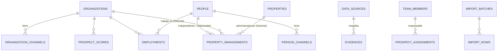

# Growth Suite — Plan técnico de la Fase 1: EntryLink Prospect

> Estado: **propuesta, pendiente de aprobación**. Nada de este plan se ha ejecutado.
> Depende de la fase 0 (PR #270, borrador, sin fusionar).
> Diseño general: `docs/superpowers/specs/2026-10-30-growth-suite-design.md`.

## 0. Alcance

Investigar, registrar, relacionar, validar, deduplicar y priorizar empresas administradoras, administradores independientes y copropiedades de Bogotá, con trazabilidad de fuentes. Meta: **100 prospectos validados**.

**Fuera de alcance (fases siguientes):** contacto comercial (correo, WhatsApp, secuencias), pipeline de oportunidades, propuestas y enriquecimiento automático con APIs de pago. Nada en esta fase convierte un registro en contacto comercial autorizado.

**Stack:** backend NestJS existente (`src/modules/growth`, esquema `growth`), web Next.js existente (`entrylink-web`), BullMQ y Redis existentes para las importaciones, y R2 privado para los archivos importados.

---

## 1. Conceptos

| Concepto | Qué es | Tabla |
|---|---|---|
| **Empresa administradora** | Persona jurídica que administra copropiedades | `organizations` |
| **Persona** | Persona natural: administrador independiente, empleado de una empresa o miembro del consejo. **Dato personal** | `people` |
| **Copropiedad** | Conjunto, edificio u otra propiedad horizontal | `properties` |
| **Vínculo laboral** | Persona ↔ empresa, con fechas | `employments` |
| **Administración** | Copropiedad ↔ quien la administra (empresa o persona), con fechas e historial | `property_managements` |
| **Prospecto** | Lo que se prioriza y se asigna: una **empresa**, un **administrador independiente** (persona con administraciones directas) o una **copropiedad autogestionada** | vista `v_prospects` |

**Prospecto validado (meta):** empresa o administrador independiente en estado `VALIDATED`, con revisión humana aprobada y evidencia verificada de los campos críticos: nombre o razón social; NIT si es empresa; al menos un canal corporativo; al menos una copropiedad vinculada con su fuente.

---

## 2. Modelo de datos (esquema `growth`, migraciones nuevas)

Convenciones de la fase 0: `uuid`, CHECK en lugar de enums nativos, auditoría (`created_*`, `updated_*`), sin FK hacia `public` salvo `users`, eventos en `activity_events` dentro de la misma transacción.

### 2.1 Estado de validación (compartido)

`validation_status` CHECK IN (`NEW`, `PENDING_REVIEW`, `IN_VALIDATION`, `VALIDATED`, `REJECTED`, `DUPLICATE`, `INCOMPLETE`).

Transiciones permitidas (servicio + trigger):

```
NEW → PENDING_REVIEW | INCOMPLETE | DUPLICATE
INCOMPLETE → PENDING_REVIEW
PENDING_REVIEW → IN_VALIDATION (toma un revisor)
IN_VALIDATION → VALIDATED | REJECTED | INCOMPLETE | DUPLICATE
VALIDATED → PENDING_REVIEW (solo si cambia un campo crítico: revalidación)
REJECTED → PENDING_REVIEW (reapertura con motivo)
DUPLICATE → (terminal; solo por fusión)
```

- `VALIDATED` exige `validated_by_user_id` y `validated_at` (CHECK).
- Quien registró un dato no puede validarlo (separación de funciones, en el servicio). SUPER_ADMIN es la excepción mientras el equipo sea de una persona; queda configurable.

### 2.2 Tablas

**`organizations`**: `legal_name`, `trade_name`, `nit` (normalizado; único parcial `WHERE merged_into_id IS NULL AND deleted_at IS NULL`), `nit_check_digit`, `website`, `domain` (normalizado), `address`, `address_normalized`, `city` (default Bogotá), `locality` (CHECK con las 20 localidades), `estimated_properties int`, `estimated_units int`, `interest_signal` (CHECK IN `NONE`, `EXPRESSED`, `DEMO_REQUESTED`), `validation_status`, `validated_*`, `merged_into_id` (FK a sí misma), `last_verified_at`, `owner_member_id` (FK `team_members`), `deleted_at`.

**`organization_channels`**: `organization_id`, `kind` CHECK IN (`PHONE`, `EMAIL`, `WEBSITE`, `SOCIAL`), `social_network`, `value`, `value_normalized`, `is_corporate boolean` (debe ser `true`: un canal personal va en `person_channels`), `verified_at`, `verified_by_user_id`. Índice en (`kind`, `value_normalized`) para deduplicar.

**`people`** (dato personal):
- `full_name`, `name_normalized`, `identity_hint`: solo el tipo y el último dígito si llega a ser necesario; **no se guarda el número de cédula**.
- `legal_basis` CHECK IN (`PENDING_LEGAL_REVIEW`, `PUBLIC_DATA`, `PRIOR_AUTHORIZATION`, `CONTRACT`, `LEGAL_OBLIGATION`), default `PENDING_LEGAL_REVIEW`.
- `processing_purpose`, `source_id` (FK `data_sources`), `last_verified_at`, `last_interaction_at`.
- `retention_review_at`: columna generada = `greatest(last_verified_at, last_interaction_at, created_at) + 12 meses`.
- `anonymized_at`, `validation_status`, `merged_into_id`, `deleted_at`.

**`person_channels`**: igual que `organization_channels`, más `is_corporate`. El correo o teléfono corporativo de una persona (p. ej. `admin@empresa.co`) sigue siendo dato personal si la identifica.

**`properties`**:
- `name`, `name_normalized`.
- `ph_type` CHECK IN (`RESIDENCIAL`, `MIXTA`, `COMERCIAL`).
- `building_kind` CHECK IN (`CONJUNTO_CASAS`, `CONJUNTO_APARTAMENTOS`, `EDIFICIO`, `MIXTO`, `OTRO`).
- `address`, `address_normalized`, `city`, `locality`, `neighborhood`, `estimated_units`.
- `real_estate_registration` (matrícula inmobiliaria, normalizada, opcional), `nit`, `geom geography(Point)` (opcional).
- `info_status` CHECK IN (`PARTIAL`, `COMPLETE`, `OUTDATED`), `validation_status`, `merged_into_id`, `deleted_at`.

**`employments`**:
- `person_id`, `organization_id`, `role_title`, `started_on`, `ended_on`, `status` CHECK IN (`CURRENT`, `PAST`, `UNCONFIRMED`).
- CHECK `ended_on >= started_on`; CHECK `status = 'PAST'` ⇔ `ended_on IS NOT NULL`.
- Sin unicidad persona-empresa: una persona puede volver a la misma empresa en otro periodo.

**`property_managements`**:
- `property_id`, `manager_type` CHECK IN (`ORGANIZATION`, `PERSON`, `SELF_MANAGED`), `organization_id`, `person_id`.
- `responsible_person_id`: el administrador responsable designado por la empresa; solo si está validado.
- `started_on`, `ended_on`, `status` (`CURRENT`, `PAST`, `UNCONFIRMED`).
- CHECK de coherencia: `ORGANIZATION` ⇒ `organization_id` NOT NULL; `PERSON` ⇒ `person_id` NOT NULL; `SELF_MANAGED` ⇒ ambos NULL.
- Índice único parcial: **una sola administración `CURRENT` por copropiedad**. Cambiar de administrador cierra la vigente y abre otra en la misma transacción, así queda el historial.

**`evidences`**:
- `entity_type`, `entity_id`, `field`, `observed_value`.
- `source_id` (FK `data_sources`; la fuente debe estar ACTIVE al registrar la evidencia, lo valida el servicio), `url`, `consulted_at`.
- `reliability` CHECK IN (`HIGH`, `MEDIUM`, `LOW`), `verification_status` CHECK IN (`UNVERIFIED`, `VERIFIED`, `DISPUTED`, `OBSOLETE`), `verified_by_user_id`, `verified_at`, `captured_by_user_id`, `notes`.
- Es polimórfica a propósito (como `legal_holds`): el servicio valida la existencia con un mapa `EVIDENCEABLE`. Las evidencias no se borran; quedan `OBSOLETE`.

**`prospect_assignments`**:
- `organization_id` | `person_id` | `property_id` (CHECK exactamente uno), `team_member_id`, `assigned_by_user_id`, `reason`, `started_at`, `ended_at`.
- Índice único parcial: un responsable vigente por prospecto. Reasignar cierra y abre en la misma transacción.

**`duplicate_candidates`**:
- `entity_type` CHECK IN (`ORGANIZATION`, `PERSON`, `PROPERTY`), `left_id`, `right_id` (CHECK `left_id < right_id`, único por par).
- `matched_on text[]` (`NIT`, `REGISTRATION`, `NAME`, `ADDRESS`, `PHONE`, `DOMAIN`), `score numeric(5,2)`.
- `status` CHECK IN (`PENDING`, `MERGED`, `DISMISSED`), `resolved_by_user_id`, `resolved_at`, `resolution_note`.

**`merge_log`** (append-only, trigger):
- `entity_type`, `survivor_id`, `merged_id`, `moved jsonb` (cuántas relaciones y evidencias se movieron), `field_choices jsonb` (qué valor se conservó por campo), `merged_by_user_id`, `created_at`.
- Fusionar **no borra**: el registro absorbido queda con `merged_into_id` y `validation_status = DUPLICATE`.

**`scoring_rules`**:
- `key`, `label`.
- `predicate` CHECK IN una **lista cerrada** de predicados implementados (`ORG_PROPERTIES_GTE`, `ORG_PROPERTIES_BETWEEN`, `UNITS_GT`, `VERIFIED_CORPORATE_CHANNEL`, `INTEREST_SIGNAL_IN`, …), `params jsonb`, `points int`, `active`, `sort_order`.
- No se evalúa código ni expresiones libres desde la base.

**`scoring_settings`**: fila única con `high_threshold`, `medium_threshold` y `version` (sube con cada cambio de reglas).

**`prospect_scores`**: `organization_id` | `person_id` | `property_id`, `score`, `priority` CHECK IN (`HIGH`, `MEDIUM`, `LOW`), `breakdown jsonb` (regla → puntos), `rules_version`, `computed_at`. Se recalcula por evento (cambio del prospecto o de las reglas) en la cola `growth-scoring`.

**`import_batches`**:
- `target` CHECK IN (`ORGANIZATIONS`, `PROPERTIES`, `PEOPLE`), `source_id` (FK; obligatorio y ACTIVE), `file_name`, `r2_key` (privado), `file_sha256` (avisa si el archivo ya se importó).
- `column_mapping jsonb`, `status` CHECK IN (`UPLOADED`, `MAPPED`, `VALIDATING`, `VALIDATED`, `COMMITTING`, `COMMITTED`, `FAILED`, `CANCELLED`), contadores, `created_by_user_id`.

**`import_rows`**: `batch_id`, `row_number`, `raw jsonb`, `mapped jsonb`, `errors jsonb`, `duplicate_hint jsonb`, `decision` CHECK IN (`CREATE`, `SKIP`, `LINK_EXISTING`), `result_entity_id`.

> **Retención de importaciones:** `raw` contiene datos personales. Se vacía (`raw = NULL`) a los 30 días de cerrado el lote, y el archivo en R2 se borra igual. Lo hace un cron, que registra el evento.

### 2.3 Extensiones y funciones

- `pg_trgm` (similitud de nombres) y `unaccent`, con un wrapper `growth.immutable_unaccent` para poder indexar. Requiere `CREATE EXTENSION`, que en producción necesita el privilegio adecuado: **verificar con el usuario de la base de Coolify antes del despliegue**.
- Índices GIN trigram sobre `name_normalized` de las tres entidades.

### 2.4 Diagrama



---

## 3. Deduplicación

| Señal | Normalización | Peso |
|---|---|---|
| NIT | sin puntos ni DV | coincidencia exacta = candidato fuerte (100) |
| Matrícula inmobiliaria | sin espacios ni guiones, mayúsculas | exacta = 100 |
| Dominio web | sin `www`, minúsculas | exacta = 80 (excepto dominios genéricos: gmail, hotmail, outlook, yahoo, live) |
| Teléfono | E.164 | exacta = 60 |
| Nombre | minúsculas, sin tildes, sin "S.A.S.", "LTDA", "P.H.", "CONJUNTO RESIDENCIAL"… | trigram ≥ 0.6 → 30–60 |
| Dirección | Bogotá canónica (`CL`, `KR`, `AK`, `AC`, `DG`, `TV` + número + placa) | exacta = 50; misma vía y número ±2 = 25 |

- Se calcula en la cola `growth-dedupe` tras cada alta, edición o importación.
- Con puntaje ≥ 50 se crea un `duplicate_candidate`. **Nunca se fusiona solo.**
- Fusionar exige el permiso `MERGE_GROWTH_DUPLICATES`, una elección explícita de valor por campo en conflicto y una confirmación. Mueve relaciones, evidencias y asignaciones al sobreviviente y lo registra todo en `merge_log`.

---

## 4. Scoring

- Reglas iniciales sembradas exactamente como en el requerimiento: 10+ copropiedades +40, 5–9 +30, 2–4 +20, >500 unidades +20, canal corporativo verificado +10, interés demostrado +20.
- Umbrales iniciales **propuestos**: alta ≥ 50, media ≥ 25, baja < 25. Son configurables.
- El número de copropiedades sale de las administraciones `CURRENT` validadas; si no hay, del estimado declarado, marcado como estimado en el desglose.
- Cambiar las reglas sube la versión y recalcula todo en segundo plano. El desglose muestra por qué cada prospecto tiene su puntaje.
- El puntaje **no** autoriza contacto: solo ordena la bandeja.

---

## 5. Importaciones (CSV y XLSX)

Flujo en 5 pasos, cada uno con su estado:

1. **Subir:** máximo 5 MB y 5.000 filas; fuente obligatoria. El archivo va a R2 privado y se calcula su hash.
2. **Vista previa:** primeras 20 filas y encabezados detectados.
3. **Mapeo:** columna → campo, con sugerencia automática por nombre de encabezado. El mapeo se puede guardar como plantilla.
4. **Validar** (cola `growth-import`): normaliza, valida formato (NIT, correo, teléfono, localidad) y marca duplicados contra la base y dentro del mismo archivo. Resultado: informe por fila y decisión sugerida (`CREATE`, `SKIP` o `LINK_EXISTING`).
5. **Confirmar:** crea registros en estado `NEW` (nunca `VALIDATED`), con evidencia de la fuente del lote, y genera el informe de errores descargable (XLSX).

Seguridad del parser:
- Límites de tamaño y de filas.
- Solo la primera hoja.
- Sin fórmulas: se leen valores.
- Al exportar el informe se neutraliza la inyección de fórmulas (celdas que empiezan con `=`, `+`, `-` o `@`).
- Se usa la librería de Excel que ya usa el backend en `excel-import` (a verificar en el código antes de implementar).

---

## 6. Permisos nuevos (inactivos hasta activar, como en la fase 0)

| Permiso | Nivel | Manager | Sales | Researcher | Compliance |
|---|---|---|---|---|---|
| `VIEW_GROWTH_PROSPECTS` (solo los asignados) | LOW | ✓ | ✓ | ✓ | ✓ |
| `VIEW_ALL_GROWTH_PROSPECTS` | MEDIUM | ✓ | | ✓ | ✓ |
| `EDIT_GROWTH_PROSPECTS` | MEDIUM | ✓ | ✓ | ✓ | |
| `VIEW_GROWTH_CONTACT_DATA` (canales de personas) | CRITICAL | ✓ | ✓ | ✓ | ✓ |
| `VALIDATE_GROWTH_PROSPECTS` | HIGH | ✓ | | | |
| `MERGE_GROWTH_DUPLICATES` | HIGH | ✓ | | | |
| `ASSIGN_GROWTH_PROSPECTS` | HIGH | ✓ | | | |
| `IMPORT_GROWTH_DATA` | HIGH | ✓ | | ✓ | |
| `MANAGE_GROWTH_SCORING` | HIGH | ✓ | | | |
| `ANONYMIZE_GROWTH_PEOPLE` | CRITICAL | | | | ✓ |

- Sin `VIEW_GROWTH_CONTACT_DATA`, los canales de personas llegan enmascarados (`a***@empresa.co`, `+57 300 *** **67`) por un resolver de campo, no solo en la interfaz.
- Ver por asignación: sin `VIEW_ALL_GROWTH_PROSPECTS`, las listas filtran por el responsable vigente en el servicio.

---

## 7. Contratos GraphQL (resumen)

Prefijo `growth`, paginación de máximo 100 y ningún argumento llamado `complexId`.

- **Consultas:**
  - `growthDashboard`;
  - `growthOrganizations(filter, pagination)` / `growthOrganization(id)`;
  - `growthProperties(…)` / `growthProperty(id)`;
  - `growthPeople(…)` / `growthPerson(id)`;
  - `growthReviewQueue(filter)`;
  - `growthDuplicateCandidates(filter)`;
  - `growthScoringRules`;
  - `growthImportBatches` / `growthImportBatch(id)` / `growthImportRows(batchId, filter)`;
  - `growthRetentionDue`.
- **Mutaciones:**
  - alta y edición de las tres entidades y de sus canales;
  - `growthLinkEmployment` / `growthEndEmployment`;
  - `growthSetPropertyManager` (cierra la vigente y abre la nueva);
  - `growthAddEvidence` / `growthVerifyEvidence` / `growthMarkEvidenceObsolete`;
  - `growthSubmitForReview` / `growthTakeForValidation` / `growthDecideValidation` / `growthReopen`;
  - `growthAssignProspect`;
  - `growthMergeDuplicates` / `growthDismissDuplicate`;
  - `growthUpdateScoringRule` / `growthUpdateScoringThresholds`;
  - `growthStartImport` (multipart REST, como las importaciones existentes) / `growthMapImportColumns` / `growthSetImportRowDecision` / `growthCommitImport` / `growthCancelImport`;
  - `growthAnonymizePerson`.
- **Sin mutaciones de borrado físico:** las entidades se descartan (`REJECTED`) o se fusionan.

`growthDashboard` devuelve los conteos por estado y tipo, las unidades estimadas (suma de validadas y de no validadas, por separado), los prioritarios, los últimos 20 eventos de actividad y el progreso hacia la meta de 100.

---

## 8. Interfaz web (`entrylink-web`, rama desde `master`)

### Ubicación

**Propuesta:** un segmento nuevo `app/growth/` **fuera de `/dashboard`**. Hoy `/dashboard` arrastra la lógica de conjunto seleccionado, pánico, sockets por conjunto y suscripción, que no aplica a la suite. Se reutilizan la sesión, Apollo, el proxy `/graphql`, los persisted queries y los primitivos de `components/ui`, extendidos.

- `middleware.ts`: proteger también `/growth`.
- Layout de `/growth`: valida en el cliente que el usuario tenga algún permiso `GROWTH_*` o sea SUPER_ADMIN. El backend es quien realmente protege.
- Sidebar actual: un acceso "Growth Suite" solo para quien tenga permisos de la suite.

### Tema

Variables CSS con alcance `[data-theme="growth"]`; no cambian el resto de la web:

| Token | Valor propuesto |
|---|---|
| Fondo | azul noche `#0A1020` |
| Superficie | azul grisáceo `#111A2C` / elevada `#17223A` |
| Borde | `#24304A` |
| Texto | `#E6ECF5` / secundario `#93A1B8` |
| Acento | cyan `#22D3EE` (hover `#67E8F9`) |
| Estados | validado `#34D399`, pendiente `#FBBF24`, rechazado `#F87171`, duplicado `#A78BFA` |

Contraste AA verificado. Tablas densas (filas de 36 px), filtros persistentes en la URL, atajos de teclado en la bandeja de validación, paneles laterales para ver el detalle sin perder la lista.

### Pantallas

| Ruta | Contenido |
|---|---|
| `/growth` | Dashboard: indicadores, progreso hacia 100, prioritarios, actividad reciente |
| `/growth/empresas`, `/[id]` | Lista densa y ficha: canales, copropiedades administradas (vigentes e históricas), personas, evidencias por campo, puntaje con desglose, historial |
| `/growth/copropiedades`, `/[id]` | Lista y ficha con historial de administración |
| `/growth/personas`, `/[id]` | Lista y ficha (canales enmascarados según permiso), base de tratamiento visible, vínculos en el tiempo |
| `/growth/validacion` | Bandeja: tomar, revisar evidencias y decidir |
| `/growth/duplicados` | Comparación lado a lado y fusión con elección por campo |
| `/growth/importaciones`, `/nueva` | Historial y asistente de 5 pasos |
| `/growth/admin/scoring` | Reglas y umbrales, con vista previa del impacto |
| `/growth/admin/equipo`, `/fuentes`, `/cumplimiento` | Pantallas de la fase 0 (equipo, fuentes, exclusiones, solicitudes, retenciones) |
| `/growth/actividad` | Registro de actividad filtrable |

---

## 9. Protección de datos en esta fase

- Personas: se pueden registrar con `PENDING_LEGAL_REVIEW`. Esta fase no tiene ninguna función de contacto, y la fase 3 impedirá contactar a quien no tenga una base validada (CHECK).
- Canales personales enmascarados sin `VIEW_GROWTH_CONTACT_DATA` (en el servidor).
- Toda persona nace con fuente obligatoria: no se crea una persona sin evidencia de dónde salió su dato.
- Antes de crear o importar una persona, su correo o teléfono se cruza con la lista de exclusión. Si está excluida, **no se registra el dato de contacto** y se avisa.
- Retención: `growthRetentionDue` lista las personas no convertidas con revisión vencida (12 meses). `growthAnonymizePerson` las anonimiza: reemplaza nombre y canales, conserva el resto agregado, salta las que tengan retención legal y registra el evento. Es un procedimiento manual y controlado; no hay borrado automático.
- Los archivos importados y las filas crudas se eliminan a los 30 días.

---

## 10. Entregas (cada una con su PR, bandera apagada, sin merge sin aprobación)

| # | Entrega | Repo | Criterio de salida |
|---|---|---|---|
| 1A | Modelo de datos, CRUD de las tres entidades, canales, vínculos, historial de administración, evidencias, flujo de validación, asignaciones, permisos | backend | matriz de permisos + integración con Postgres real en verde |
| 1B | Deduplicación (cola) + fusión controlada + scoring configurable (cola) | backend | casos de duplicado sembrados detectados; fusión sin pérdida en `merge_log` |
| 1C | Importaciones CSV/XLSX (cola, R2, informe, retención de 30 días) | backend | lote de 500 filas con errores y duplicados sembrados |
| 1D | Shell `/growth`, tema oscuro, dashboard, empresas, copropiedades, personas, bandeja de validación | web | flujo capturar → evidencia → validar en local contra la API |
| 1E | Duplicados, asistente de importación, scoring, equipo, fuentes, cumplimiento y actividad | web | prueba completa local |

Todas son ramas apiladas sobre la fase 0 (backend) mientras #270 no se fusione. Antes de fusionar cada una se reapunta a `main`, porque el CI y el despliegue solo miran `main`.

**Despliegue controlado:**
1. #270 → 2. backend 1A–1C → 3. web 1D–1E (sin `[deployd]` en el título hasta autorizar). Siempre con `GROWTH_ENABLED=false`.
4. Activación en producción según `docs/growth/ACTIVATION.md`, solo con autorización expresa.

---

## 11. Pruebas

- **Unitarias:** normalizadores (nombre, dirección de Bogotá, matrícula, dominio genérico), puntaje de duplicados, cada predicado de scoring, transiciones de validación, separación de funciones, enmascaramiento, parser con archivos maliciosos (fórmulas, tamaño, filas).
- **Autorización:** se extiende la matriz de la fase 0 a las operaciones nuevas, incluido el filtro por asignación.
- **Integración con Postgres real:**
  - unicidad de NIT y de la administración vigente;
  - CHECK de administración;
  - transiciones inválidas rechazadas por trigger;
  - fusión que mueve todo y deja `merge_log`;
  - importación completa con la cola;
  - anonimización que respeta retenciones legales.
- **Web:** Vitest en los componentes de tabla, filtros, enmascarado y asistente; prueba manual guiada del flujo completo.
- **Aislamiento:** las specs de la fase 0 siguen en verde; ninguna entidad nueva sale del esquema `growth`.

---

## 12. Riesgos

| Riesgo | Mitigación |
|---|---|
| `CREATE EXTENSION pg_trgm`/`unaccent` sin privilegios en producción | verificar antes; plan B: similitud en la aplicación (más lenta, suficiente para miles de registros) |
| Ramas apiladas sin CI | correr CI local; reapuntar a `main` antes de fusionar |
| Persisted queries: la web en producción solo acepta operaciones del manifiesto | publicar el manifiesto en el orden documentado (backend → manifiesto → web) |
| Datos personales en importaciones | límites, retención de 30 días, cruce con exclusiones, fuente obligatoria |
| Fusión incorrecta | solo manual, con elección por campo y registro completo; reversión manual documentada con `merge_log` |
| Tema oscuro desentona con el resto de la web | alcance por `data-theme` solo en `/growth` |
| Volumen de la fase (5 entregas) | entregas independientes con criterio de salida; se puede pausar entre una y otra |

## 13. Decisiones que necesito

1. ¿Ramas apiladas sobre la fase 0 (recomendado) o esperar a fusionar #270?
2. ¿Interfaz en `entrylink-web` bajo `/growth` (recomendado) o una aplicación aparte (p. ej. `growth.alternaqj.com`)?
3. ¿Registrar personas antes de la validación jurídica, con `PENDING_LEGAL_REVIEW`, canales enmascarados y sin contacto posible (recomendado), o solo datos empresariales hasta tener el concepto del abogado?
4. ¿Separación de funciones estricta (quien captura no valida) desde ya, o con excepción para SUPER_ADMIN mientras el equipo sea de una persona (recomendado)?
5. ¿Umbrales de prioridad alta ≥ 50 y media ≥ 25?

---

## 14. Decisiones aprobadas (2026-10-30)

1. Ramas apiladas sobre la fase 0: `feat/growth-prospect-1a` sale de `feat/growth-suite-fase-0` (#270). Cada PR declara su dependencia y se reapunta a `main` antes de fusionar.
2. Interfaz en `entrylink-web` bajo `/growth`, con tema aislado por `[data-theme="growth"]`.
3. Personas registrables desde esta fase. `PENDING_LEGAL_REVIEW` es un **bloqueo real** en el backend.
4. Quien registra no valida. Excepción para `SUPER_ADMIN_ROL`, registrada en auditoría y desactivable (`growth.settings.allow_super_admin_self_validation`).
5. Umbrales de prioridad: alta ≥ 50, media 25–49, baja < 25.
6. Ejecución por entregas. **Solo 1A** hasta su aprobación.

### Ajustes incorporados

| Ajuste | Diseño |
|---|---|
| **A. Independientes** | Empresa validada: canal corporativo **verificado**. Administrador independiente validado: canal `PROFESSIONAL` verificado, **o** canal `DIRECT` verificado con base jurídica distinta de `PENDING_LEGAL_REVIEW` y referencia documentada |
| **B. Bloqueo jurídico** | `people.contact_status` (`NOT_AUTHORIZED`, `AUTHORIZED`, `REVOKED`). CHECK en la base: `AUTHORIZED` exige base distinta de `PENDING_LEGAL_REVIEW`, referencia y revisión registradas, y persona no anonimizada. Volver a `PENDING_LEGAL_REVIEW` obliga a revocar en la misma operación. La vista `growth.v_contactable_person_channels` es el único punto de entrada que tendrá Outreach |
| **C. HMAC** | Se mantiene el llavero versionado de la fase 0 (escritura con la llave activa, consulta con todas, re-hash oportunista, falla cerrada) |
| **D. Importaciones (1C)** | Purga de archivo y filas crudas 30 días después de que el lote termine en `COMMITTED`, `FAILED` o `CANCELLED`. El evento registra el lote, los conteos y la fecha, nunca los datos |
| **E. Fusiones (1B)** | Solo manuales, con valor elegido por campo, historial conservado, relaciones y evidencias trasladadas, y `merge_log` append-only |

---

## 15. Entrega 1A — alcance exacto

**Incluye:** organizaciones, personas, copropiedades, canales, vínculos laborales, historial de administración, evidencias, asignaciones con historial, flujo de validación con trigger de transiciones, separación de funciones, base jurídica y bloqueo de contacto, enmascaramiento en el servidor, cruce con la lista de exclusión antes de guardar canales, configuración (`growth.settings`), estadísticas para el dashboard y permisos.

**No incluye:** deduplicación, fusiones, scoring (1B); importaciones (1C); interfaz (1D/1E); anonimización (va con 1E, junto a su pantalla de administración).

**Fuentes:** toda alta exige una fuente `ACTIVE` y genera evidencia de cada campo informado. En producción ninguna fuente nace activa: antes de capturar hay que completar su revisión jurídica (fase 0).

### Permisos de 1A (inactivos hasta la activación)

| Permiso | Nivel | Manager | Sales | Researcher | Compliance (al activar) |
|---|---|---|---|---|---|
| `VIEW_GROWTH_PROSPECTS` | LOW | ✓ | ✓ | ✓ | ✓ |
| `VIEW_ALL_GROWTH_PROSPECTS` | MEDIUM | ✓ | | ✓ | ✓ |
| `EDIT_GROWTH_PROSPECTS` | MEDIUM | ✓ | ✓ | ✓ | |
| `VIEW_GROWTH_CONTACT_DATA` | CRITICAL | ✓ | ✓ | ✓ | ✓ |
| `VALIDATE_GROWTH_PROSPECTS` | HIGH | ✓ | | | |
| `ASSIGN_GROWTH_PROSPECTS` | HIGH | ✓ | | | |
| `REVIEW_GROWTH_LEGAL_BASIS` | CRITICAL | | | | ✓ |
| `AUTHORIZE_GROWTH_CONTACT` | CRITICAL | | | | ✓ |

---

## 16. Referencias visuales para 1D (aportadas por el usuario)

Dos imágenes de referencia (`OneDrive/Imágenes/marketing entrylink`):

1. **CRM de leads, azul noche:**
   - fila de KPI en tarjetas con cifra grande y variación;
   - pestañas de estado con conteo;
   - tabla densa con barra de puntaje por fila y filtros en píldoras (estado, fuente, responsable);
   - panel lateral de "prospectos prioritarios" con puntaje y responsable;
   - línea de tiempo de actividad;
   - donut de fuentes;
   - superficies azul grisáceo con borde sutil y acento azul/cyan con brillo suave.
2. **Inteligencia inmobiliaria, oscura:**
   - mapa con marcadores numerados y lista lateral de propiedades como tarjetas;
   - indicadores circulares;
   - gráficas de área.

Aplicable a Prospect en 1D:
- KPI de meta (x/100);
- pestañas por estado de validación;
- tabla con barra de puntaje y prioridad;
- panel de prioritarios;
- actividad reciente;
- donut de fuentes;
- mapa de copropiedades por localidad (fase posterior: exige geocodificación).

Adaptación obligatoria: acento **cyan** (no violeta), contraste AA, iconos SVG (lucide, ya en la web), cifras tabulares, sin fotos de personas (dato personal: iniciales en su lugar).
