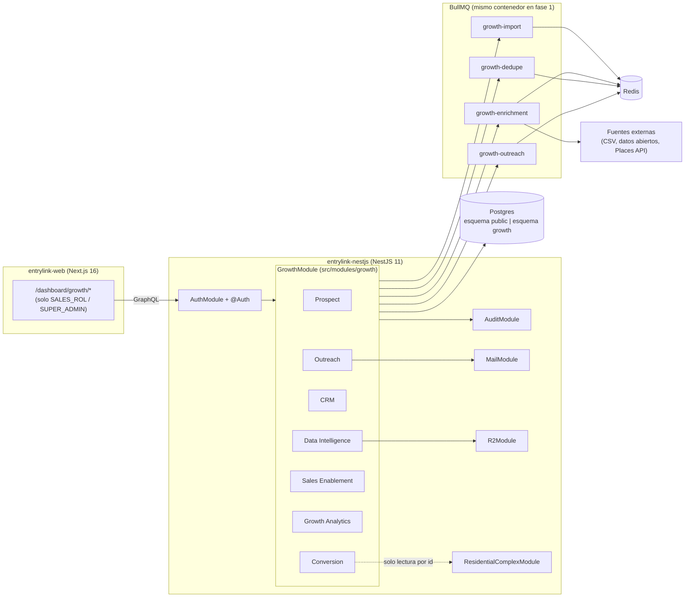
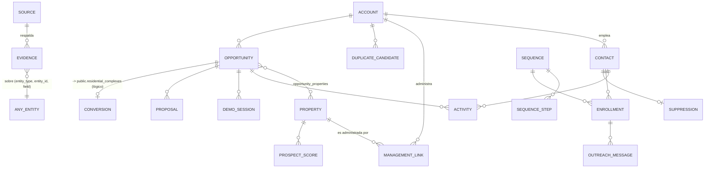

# EntryLink Growth Suite — Diseño de arquitectura (Fase 0)

> Estado: **propuesta, sin implementar**. Nada de esto toca producción hasta aprobar el plan.
> Fecha: 2026-10-30 · Alcance inicial: Bogotá, meta 100 prospectos validados.

---

## 1. Arquitectura encontrada (inspección real, no supuesta)

Corrección al brief: el backend **no es Next.js**. Hay dos piezas:

| Pieza | Repo / ruta | Stack real |
|---|---|---|
| API | `BACKEND/phone-dialer-nestjs` (imagen `ghcr.io/maicolqj/entrylink-nestjs`) | NestJS 11, GraphQL code-first (Apollo 5), TypeORM, PostgreSQL 17 + PostGIS, Redis 7.2, BullMQ, Socket.IO, R2 |
| Web | `FRONTEND/nextjs/entrylink-web` (rama base `master`) | Next.js 16, React 19, Apollo Client 4, graphql-codegen, Tailwind 4, zustand, zod, Sentry |
| Apps | RemoteLink (residentes), EntryLinkApp (portería) | React Native — **fuera de alcance** de la suite |

### 1.1 Piezas reutilizables encontradas

| Necesidad de la suite | Ya existe | Dónde |
|---|---|---|
| Autenticación JWT + refresh + sesiones | Sí | `src/modules/auth`, `JwtAccessPayload` (`entityType`, `roles`, `permissions`, `complexId?`) |
| Autorización rol/permiso | Sí | `@Auth({ roles, permissions })` → `JwtAuthGuard` + `UniversalRolePermissionGuard` + `ComplexModuleGuard` + `SubscriptionGuard` |
| Excepciones por usuario (GRANT/DENY) | Sí | `user_permission_overrides` + `tokenVersion` |
| Permisos con nivel y dependencias | Sí | `ValidPermissions` + `level-permissions.ts` |
| Auditoría | Sí | `audit_logs` (`entity_type`, `entity_id`, `previous_value`/`new_value` jsonb, `performed_by_*`, `complex_id` nullable) |
| Colas | Sí | BullMQ: `mail`, `otp`, `excel-import`, `residents-import`, `panic-escalation`; Bull Board |
| Importación de Excel/CSV en cola | Sí | patrón `excel-import` / `residents-import` |
| Correo saliente | Sí | `MailModule` + cola `mail`, Resend en prod |
| WhatsApp Cloud API | Sí, **con incidente abierto** (`131042`) | no apto para outreach hasta resolver |
| Archivos privados | Sí | R2 (llaves privadas, sin URL pública) |
| Exportación Excel | Sí | `data-export` |
| Errores tipados | Sí | `CustomError` + `errorCode` por dominio |
| Embudo de conversión actual | Parcial | `registerComplex` (REST), `engagement` PILOT/COMMERCIAL, `complex_referrals`, suscripciones |
| Migraciones | Sí | `src/core/database/migrations` (102), corren solas al arrancar, `migrationsTransactionMode: 'each'` |
| CI/CD | Sí | `ci.yml` → `docker-publish.yml` → `deploy.yml` (Coolify + health check) solo desde `main` |

### 1.2 Hallazgos que condicionan el diseño

1. **Los guards toleran usuarios sin `complexId`** (`complex-module.guard.ts:95`): un rol interno de ventas funciona sin tenancy.
2. **Trampa**: `ComplexModuleGuard` lee `complexId` de los argumentos o de `input`. Ningún input de la suite debe llamar a un campo `complexId`; usar `convertedComplexId`.
3. **Recursos limitados**: un solo VPS, Postgres con `max_connections=50`, `shared_buffers=128MB`. Un servicio aparte con su propio pool compite por lo mismo.
4. **Tope de paginación 100** ya es convención; la suite la respeta.
5. Las notificaciones tienen audiencias RESIDENT/STAFF/ANY por conjunto; la suite **no** las usa (no hay conjunto).

---

## 2. Decisión de arquitectura

### Recomendado: monolito modular con esquema Postgres propio

```
src/modules/growth/           ← un solo GrowthModule, registrado solo si GROWTH_ENABLED=true
```

- Tablas en el esquema **`growth`** (no `public`). Aislamiento físico de los datos de residentes.
- **Prohibido** que un servicio de `growth` inyecte repositorios de `residents`, `users` (salvo el usuario actual), `units`, `visitors`, etc. Regla de ESLint `no-restricted-imports` sobre `src/modules/growth/**`.
- Único cruce permitido: `ConversionService` lee `residential_complexes` por id para enlazar un prospecto convertido. Sin FK desde `growth` hacia `public` (enlace lógico `converted_complex_id uuid`), para poder extraer el dominio más adelante.
- Bandera `GROWTH_ENABLED` (default `false`): el módulo no se monta en prod hasta aprobar cada fase.

**Por qué no un microservicio ahora:** mismo VPS y mismo Postgres → no aísla carga, duplica auth/CI/deploy y suma conexiones. El esquema separado + reglas de import dejan la extracción a un servicio aparte como un cambio mecánico cuando el volumen lo justifique.

### Diagrama de componentes



---

## 3. Cumplimiento legal (bloqueante, no opcional)

Colombia, **Ley 1581 de 2012** y **Decreto 1377 de 2013** (habeas data), vigilancia SIC.

- Datos de **personas jurídicas** (administradoras: NIT, razón social, dirección, teléfono corporativo) → sin restricción de habeas data.
- Datos de **personas naturales** (administradores independientes, contactos de una administradora) → son datos personales aunque sean públicos. Se exige:
  - finalidad declarada (contacto comercial B2B) y registro de **fuente** de cada dato;
  - aviso de privacidad en el **primer contacto** + mecanismo de exclusión;
  - **lista de supresión** global que bloquea cualquier envío;
  - retención: borrar contactos no convertidos tras N meses (propuesta: 12).
- Nada de scraping de LinkedIn ni de sitios cuyos términos lo prohíban. Google Places: respetar sus términos de almacenamiento (guardar `place_id`, refrescar el resto).
- WhatsApp: Meta exige opt-in y plantillas MARKETING; además el incidente `131042` sigue abierto. **Outreach fase 1 = correo**.
- Validar el texto del aviso con asesoría legal antes de enviar el primer correo.

---

## 4. Modelo de datos (esquema `growth`)

Convenciones del repo: UUID, `created_at/updated_at`, `created_by_user_id/updated_by_user_id`, `deleted_at` (soft delete), normalización en `BeforeInsert/BeforeUpdate`, entidad TypeORM + ObjectType en el mismo archivo.



### Fase 1 (Prospect + Data Intelligence)

| Tabla | Campos clave |
|---|---|
| `growth.accounts` | `kind` (ADMIN_COMPANY, INDEPENDENT_ADMIN, PROPERTY_SELF_MANAGED), `legal_name`, `trade_name`, `nit` (normalizado, único parcial), `city`, `locality` (localidad Bogotá), `address`, `phone`, `email`, `website`, `status` (RAW, IN_REVIEW, VALIDATED, REJECTED, DISCARDED), `owner_user_id`, `normalized_key` |
| `growth.contacts` | `account_id`, `full_name`, `role_title`, `email`, `phone`, `is_natural_person`, `legal_basis` (B2B_PUBLIC_ROLE, CONSENT), `privacy_notice_sent_at`, `status` |
| `growth.properties` | `name`, `property_type` (CONJUNTO, EDIFICIO, MIXTO, OTRO), `address`, `locality`, `upz`, `estrato`, `estimated_units`, `geom geography(Point)` (PostGIS ya instalado), `nit`, `status`, `normalized_key` |
| `growth.management_links` | `account_id`, `property_id`, `valid_from`, `valid_to`, `confidence` |
| `growth.sources` | `kind` (MANUAL, CSV_IMPORT, OPEN_DATA, PLACES_API, WEBSITE, REFERRAL), `name`, `url`, `terms_note`, `active` |
| `growth.evidences` | `entity_type`, `entity_id`, `field`, `value`, `source_id`, `url`, `r2_key` (captura privada), `captured_at`, `captured_by_user_id` |
| `growth.validation_reviews` | `entity_type`, `entity_id`, `decision`, `checklist jsonb`, `reviewer_user_id` |
| `growth.duplicate_candidates` | `entity_type`, `left_id`, `right_id`, `score`, `reasons jsonb`, `status` (PENDING, MERGED, DISMISSED) |
| `growth.import_batches` | `source_id`, `r2_key`, `status`, `rows_total/ok/failed`, `errors jsonb` |

**"Prospecto validado"** (meta 100) = `accounts.status = VALIDATED` con al menos: NIT o nombre+dirección verificados, 1 contacto con base legal, 1 evidencia por campo crítico, revisión aprobada.

### Fases siguientes (resumen)

- **CRM:** `opportunities` (stage: NEW, CONTACTED, MEETING, DEMO, PROPOSAL, PILOT, WON, LOST; `expected_units`, `expected_mrr`, `lost_reason`), `opportunity_properties`, `activities` (CALL, EMAIL, MEETING, NOTE, TASK; `due_at`, `done_at`), `prospect_scores` (`score`, `breakdown jsonb`, `model_version`).
- **Outreach:** `sequences`, `sequence_steps` (canal, plantilla, `delay_days`), `enrollments`, `outreach_messages` (`provider_message_id`, estado entregado/abierto/rebotado/respondido), `suppressions` (email/teléfono hash + motivo, global).
- **Sales Enablement:** `demo_sessions` (conjunto **demo sintético**, nunca uno real), `proposals` (cotización calculada con `subscription_plan_prices` + `subscription_taxes` existentes, PDF privado en R2).
- **Conversion:** `conversions` (`opportunity_id`, `converted_complex_id`, `engagement` PILOT/COMMERCIAL, `referral_code?`). Se dispara al aprobar el registro del conjunto.
- **Analytics:** vistas SQL (`growth.v_funnel`, `v_source_yield`, `v_cohort_conversion`) → luego materializadas con refresco por cron.

---

## 5. Autorización

- Nuevo rol **`SALES_ROL`** (interno de Alterna QJ, `entityType: 'user'`, sin `complexId`). Puede convivir con otros roles como ya ocurre con `RESIDENT_ROL`.
- `SUPER_ADMIN_ROL` recibe todos los permisos `GROWTH_*`.
- `COMPILANCE_OFFICER_ROL`: solo lectura de fuentes, evidencias, supresiones y auditoría de la suite.
- Ningún rol de conjunto (`COMPLEX_ROL`, `ACCOUNTANT_ROL`, `SECURITY_ROL`, `RESIDENT_ROL`, …) obtiene permisos `GROWTH_*`.

Permisos nuevos (con nivel y dependencias, mismo formato de `valid-permissions.ts`):

| Permiso | Nivel | Requiere |
|---|---|---|
| `VIEW_GROWTH_PROSPECTS` | LOW | — |
| `EDIT_GROWTH_PROSPECTS` | MEDIUM | VIEW_GROWTH_PROSPECTS |
| `VALIDATE_GROWTH_PROSPECTS` | HIGH | EDIT_GROWTH_PROSPECTS |
| `MERGE_GROWTH_DUPLICATES` | HIGH | VALIDATE_GROWTH_PROSPECTS |
| `IMPORT_GROWTH_DATA` | HIGH | EDIT_GROWTH_PROSPECTS |
| `VIEW_GROWTH_CONTACT_DATA` | CRITICAL | VIEW_GROWTH_PROSPECTS |
| `MANAGE_GROWTH_PIPELINE` | MEDIUM | VIEW_GROWTH_PROSPECTS |
| `RUN_GROWTH_OUTREACH` | CRITICAL | MANAGE_GROWTH_PIPELINE |
| `MANAGE_GROWTH_SUPPRESSIONS` | HIGH | — |
| `VIEW_GROWTH_ANALYTICS` | LOW | — |
| `MANAGE_GROWTH_SOURCES` | HIGH | — |

Uso: `@Auth({ permissions: [ValidPermissions.EDIT_GROWTH_PROSPECTS] })`. Todas las mutaciones escriben en `audit_logs` con `complex_id = NULL` y nuevos `AuditEntityType` (`GROWTH_ACCOUNT`, `GROWTH_CONTACT`, …).

---

## 6. Contratos GraphQL — Fase 1

Prefijo `growth` en tipos y operaciones para no chocar con el esquema actual. Paginación máx. 100.

```graphql
enum GrowthAccountKind { ADMIN_COMPANY INDEPENDENT_ADMIN PROPERTY_SELF_MANAGED }
enum GrowthRecordStatus { RAW IN_REVIEW VALIDATED REJECTED DISCARDED }
enum GrowthSourceKind { MANUAL CSV_IMPORT OPEN_DATA PLACES_API WEBSITE REFERRAL }

type GrowthAccount {
  id: ID!
  kind: GrowthAccountKind!
  legalName: String!
  tradeName: String
  nit: String
  locality: String
  address: String
  status: GrowthRecordStatus!
  contacts: [GrowthContact!]!        # campos sensibles nulos sin VIEW_GROWTH_CONTACT_DATA
  managedProperties: [GrowthProperty!]!
  evidences: [GrowthEvidence!]!
  duplicateCandidates: [GrowthDuplicateCandidate!]!
  completeness: Float!               # 0..1 según checklist de validación
  createdAt: DateTime!
}

type GrowthAccountPage { items: [GrowthAccount!]! total: Int! page: Int! limit: Int! }

input GrowthAccountFilter {
  search: String
  kind: GrowthAccountKind
  status: [GrowthRecordStatus!]
  locality: String
  ownerUserId: ID
}

type Query {
  growthAccounts(filter: GrowthAccountFilter, page: Int = 1, limit: Int = 25): GrowthAccountPage!
  growthAccount(id: ID!): GrowthAccount!
  growthProperties(filter: GrowthPropertyFilter, page: Int = 1, limit: Int = 25): GrowthPropertyPage!
  growthDuplicateCandidates(status: GrowthDuplicateStatus = PENDING, page: Int = 1, limit: Int = 25): GrowthDuplicatePage!
  growthSources: [GrowthSource!]!
  growthImportBatch(id: ID!): GrowthImportBatch!
  growthProgress: GrowthProgress!     # validados / meta, por localidad
}

type Mutation {
  growthCreateAccount(input: GrowthCreateAccountInput!): GrowthAccount!
  growthUpdateAccount(id: ID!, input: GrowthUpdateAccountInput!): GrowthAccount!
  growthAddContact(accountId: ID!, input: GrowthContactInput!): GrowthContact!
  growthCreateProperty(input: GrowthCreatePropertyInput!): GrowthProperty!
  growthLinkManagement(accountId: ID!, propertyId: ID!, input: GrowthManagementLinkInput): GrowthManagementLink!
  growthAddEvidence(input: GrowthEvidenceInput!): GrowthEvidence!
  growthSubmitForReview(entityType: GrowthEntityType!, id: ID!): Boolean!
  growthReview(input: GrowthReviewInput!): GrowthValidationReview!
  growthResolveDuplicate(id: ID!, action: GrowthDuplicateAction!, survivorId: ID): GrowthDuplicateCandidate!
  growthStartImport(input: GrowthImportInput!): GrowthImportBatch!   # CSV base64 → R2 → cola growth-import
  growthUpsertSource(input: GrowthSourceInput!): GrowthSource!
}
```

Errores: `GrowthErrorCode` (`GROWTH_DUPLICATE_NIT`, `GROWTH_MISSING_EVIDENCE`, `GROWTH_SUPPRESSED_CONTACT`, …) vía `CustomError`.

---

## 7. Procesamiento asíncrono

| Cola | Trabajo | Notas |
|---|---|---|
| `growth-import` | parsear CSV/XLSX, normalizar, crear RAW + evidencia `CSV_IMPORT` | reutiliza patrón de `excel-import` |
| `growth-dedupe` | tras cada alta/edición: NIT exacto, `normalized_key`, trigram (`pg_trgm`) en nombre, distancia PostGIS < 50 m | crea `duplicate_candidates`, nunca fusiona solo |
| `growth-enrichment` | conectores por fuente (fase 1b) | rate limit por fuente, `attempts` + backoff |
| `growth-outreach` | envío por paso de secuencia (fase 3) | consulta `suppressions` justo antes de enviar |

Fase 1: los workers corren en el mismo contenedor. Si la carga crece, misma imagen con `APP_PROCESS=worker` como segundo servicio en Coolify (sin GraphQL ni HTTP).

Normalización: NIT sin puntos ni DV separado, teléfonos E.164 (+57), direcciones bogotanas a forma canónica (`CL`, `KR`, `AK`, `DG`, `TV` + números), localidad desde catálogo de las 20 localidades.

---

## 8. Integración con EntryLink

- **Auth / usuarios / roles / auditoría / correo / R2 / colas:** reutilizados tal cual.
- **Web:** sección `/dashboard/growth/*` en `entrylink-web`, visible solo con permisos `GROWTH_*`; componentes y layout existentes. Codegen consume el mismo `schema.gql`.
- **Conversión:** al aprobar el registro de un conjunto (`registerComplex` + revisión existente), un evento interno (`EventEmitter`/cola) ofrece enlazarlo a una oportunidad abierta por NIT o nombre; el enlace lo confirma una persona. Los códigos de referido (`complex_referrals`) se registran como fuente `REFERRAL`.
- **Dirección única de datos:** `growth` → lee `public.residential_complexes` por id. Nunca al revés, nunca a residentes.

---

## 9. Despliegue Docker

- Sin servicios nuevos en `docker-compose.prod.yml` para la fase 1.
- Variables nuevas pasadas como referencia (`GROWTH_ENABLED=${GROWTH_ENABLED:-false}`, `GOOGLE_PLACES_API_KEY=${GOOGLE_PLACES_API_KEY}` en fase 1b), añadidas a `env-validation.ts` como opcionales.
- Migración 1: `CREATE SCHEMA IF NOT EXISTS growth` + `CREATE EXTENSION IF NOT EXISTS pg_trgm` + tablas de fase 1. Solo crea; no altera tablas de `public` → reversible con `DROP SCHEMA growth CASCADE`.
- Seed de permisos/rol `SALES_ROL` vía `seed:permissions` / `seed:roles` existentes.
- Rollout: merge con `GROWTH_ENABLED=false` → verificar health → activar en Coolify → probar → mantener.

---

## 10. Plan de pruebas

- **Unitarias (jest):** normalizadores (NIT, teléfono, dirección), scoring de duplicados, cálculo de completitud, regla "validado".
- **Guards:** spec que confirma que `SALES_ROL` no accede a ninguna operación de residentes ni de conjunto, y que roles de conjunto reciben 403 en `growth*`.
- **Aislamiento:** test de lint que falla si `src/modules/growth/**` importa de módulos operativos no permitidos.
- **Integración (e2e con Postgres):** importación CSV de 50 filas con duplicados sembrados → candidatos esperados; consultas con joins + paginación (trampa conocida del `orderBy` en query builder).
- **Migración:** `migration:run` + `migration:revert` en local sobre copia de esquema.
- **Manual en web:** flujo capturar → evidencia → revisar → validado; contador de meta.

---

## 11. Roadmap por fases

| Fase | Entrega | Criterio de salida |
|---|---|---|
| **0. Fundamentos** | esquema `growth`, bandera, `SALES_ROL`, permisos, tipos de auditoría, regla de lint | CI verde, prod sana con bandera apagada |
| **1. Prospect + Data Intelligence** | cuentas, contactos, copropiedades, fuentes, evidencias, revisión, dedupe, importación CSV, pantalla web | 100 prospectos validados en Bogotá |
| 1b. Enriquecimiento | conectores (datos abiertos Bogotá, Places API) | rendimiento por fuente medido |
| **2. CRM** | oportunidades, pipeline kanban, actividades, scoring v1 (reglas) | todas las cuentas validadas con dueño y etapa |
| **3. Outreach** | secuencias por correo (Resend), supresión, aviso de privacidad, webhooks de entrega | tasa de rebote < 5 %, 0 envíos a suprimidos |
| **4. Sales Enablement** | conjunto demo sintético, cotizador con precios reales, propuesta PDF | propuesta generada en < 2 min |
| **5. Analytics + Conversión** | embudo, rendimiento por fuente/localidad, enlace a conjunto registrado | conversión medida de punta a punta |

Cada fase: rama desde `main`, PR propio con versión (semver + `chore(release)`), PR web en `master` con `[deployd]` en el título, backend primero.

---

## 12. Decisiones tomadas (2026-10-30)

1. Monolito modular: `src/modules/growth` + esquema `growth`, extraíble a futuro. Sin microservicio.
2. Al inicio la usa el administrador principal, pero queda lista para un equipo comercial: usuarios, roles y permisos individuales, asignación con historial y actividad por usuario.
3. Fuentes públicas y autorizadas (RUES, sitios corporativos, directorios públicos, información suministrada, investigación manual, fuentes sectoriales). Google Places solo después de aprobar costo, límites y beneficio. Sin scraping de LinkedIn ni extracción indiscriminada. Cero gasto automático.
4. Revisión a los 12 meses desde la última interacción o verificación (no autoriza a conservar indefinidamente), con supresión, lista de exclusión mínima, anonimización y excepciones legales.

Plan detallado de la fase 0: `docs/superpowers/plans/2026-10-30-growth-suite-fase-0.md`.
