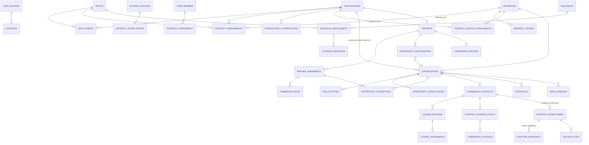
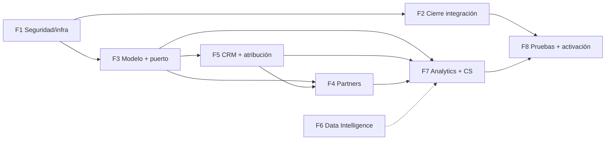

# EntryLink Growth Suite — Auditoría integral de arquitectura y diseño

_2026-11-05 · Solo análisis y documentación: no se programó, no se migró, no se corrió SQL, no se tocaron permisos, variables, secretos, PR ni despliegues._

**Fuentes verificadas directamente**, sin confiar en estados anteriores:
- código y migraciones en `origin/main` (backend) y `origin/master` (web);
- PR abiertos y fusionados (GitHub) de los cuatro repos;
- `GET https://api.alternaqj.com/health` (solo lectura) → **0.42.12**;
- despliegue de Vercel del último commit de la web → *Production, completed*.

Lo que **no** se pudo verificar sin acceso al servidor queda marcado como **[no verificado]**: variables de Coolify, estado de la base y del cron, contenido de Redis.

---

## 1. Resumen ejecutivo

1. **Lo construido es coherente y está aislado.**
   - Prospect (1A, 1B, 1C, 1E-0, scoring con versiones) está en `main` y en producción.
   - Growth solo tiene FK a `public.users` (44 referencias) y no importa módulos operativos. Lo exigen el lint (`no-restricted-imports`) y `growth-isolation.spec.ts`.
2. **Los documentos de diseño se quedaron atrás del código.**
   - El diseño base habla de `accounts`, `contacts`, `management_links`, `sources` y `validation_reviews`, y de permisos que no existen. El código usa `organizations`, `people`, `property_managements`, `data_sources` y validación dentro del registro.
   - Partners & Channels repite la definición de `opportunities` y depende de permisos futuros.
   - Sin corregirlo, la próxima fase puede duplicar entidades.
3. **El contrato GraphQL de la web está atrasado.**
   - `schema.growth.gql` no cambia desde el 2026-11-01 y le faltan **13 operaciones** del backend (plantillas #280 y versiones de scoring #281).
   - El asistente de importación sigue diciendo «con el mismo nombre se actualiza la plantilla», cuando el backend ahora lo rechaza.
   - Causa: el `schema.gql` versionado se genera con Growth apagado, así que el control de contrato de #289 **no cubre Growth**.
4. **Riesgos operativos abiertos, de mayor a menor:**
   - **no hay respaldo automático** (#298 listo, sin instalar);
   - **SUPER_ADMIN usa Growth saltándose permisos inactivos** (#287 bloqueado hasta activar los permisos);
   - `RESIDENT_ROL` duplicado (#297);
   - archivos `.dump` con datos personales en el VPS y en el PC.
5. **Customer Success & Adoption no tiene diseño.** Analytics, la conversión, las licencias de Partners y Customer Success **dependen todos de datos operativos**: hay que definir **un solo** punto de integración Growth ↔ Operación, no uno por dominio.
6. **Siguiente tarea técnica recomendada (§11):** cerrar la fase 1 (respaldo, #297, #298 y #299), y en seguida, con aprobación, la **F2-1: contrato GraphQL de Growth versionado y verificado en CI**, más la corrección de la web.

---

## 2. Estado real de implementación

### 2.1 Versiones y despliegue (verificado)

| Componente | `main`/`master` | Producción | Nota |
|---|---|---|---|
| Backend | 0.42.12 (#296) | **0.42.12** (`/health`) | `main` está completo en producción |
| Web | 0.41.3 (#210) | 0.41.3 (Vercel *Production*) | — |
| RemoteLink | 1.15.1 / vc17 (#95) | Play: **sin publicar** | APK local firmado: `C:\Users\maico\Apps\APKs\RemoteLink-1.15.1-vc17.apk` |
| EntryLinkApp | sin cambios recientes | — | #51 (Sentry/PostHog) abierto |
| `GROWTH_ENABLED` en producción | — | `true` desde 2026-11-01 **[no verificado]** | Solo consta en el handoff |
| Roles y permisos de Growth en producción | — | inactivos, 0 asignaciones **[verificado el 2026-11-04 con la consulta 09-B]** | El SUPER_ADMIN opera por la excepción (S-02) |

### 2.2 PR (verificados el 2026-11-05)

**Backend, abiertos:**

| PR | Qué | Estado | Bloqueo |
|---|---|---|---|
| #297 | `RESIDENT_ROL` duplicado + migración | borrador, CLEAN, CI verde | Espera el respaldo (F1) |
| #298 | Respaldo automático (systemd + R2) | borrador, CLEAN | Lo instala el usuario en el VPS |
| #299 | Pruebas intermitentes bajo carga | borrador, CLEAN, CI verde | — |
| #287 | SUPER_ADMIN sin permisos inactivos (0.43.0) | borrador, **UNKNOWN**: hay que rebasar y renumerar | Activar antes los permisos de Growth (S-02) |
| #291 | Dependabot: 34 actualizaciones minor/patch | CLEAN | Orden expresa |
| #188 | dotenv 18 | CLEAN, CI anterior a `integration` | `@dependabot recreate` y orden |
| #262 | IoT (matera) | UNKNOWN | Decisión de producto aparte |

**Backend de Growth, fusionados:** #270 (fase 0), #271 (1A), #273 (1B), #274 (1C), #276, #277 (1E-0), #279, #280, #281 (1E-C-0), #282, #283, #284, #286 y #289.
**Web de Growth, fusionados:** #205 y #206 (1D), #207 (1E-A), #208 (1E-B) y #209. **No hay PR abiertos en la web.**

### 2.3 Matriz de funcionalidades

V = existe · P = parcial · — = no existe

| Dominio / capacidad | Diseño | Backend | Web | Prod | Pruebas |
|---|---|---|---|---|---|
| **Fundamentos:** equipo, fuentes, actividad append-only, supresión HMAC, solicitudes Ley 1581, retenciones | V | V | **—** (ni equipo, ni fuentes, ni cumplimiento, ni actividad) | V | unitarias + int |
| **Prospect 1A:** organizaciones, personas, copropiedades, canales, empleos, administración, evidencias, validación, asignaciones | V (con otros nombres, I-01) | V | P (listas, fichas, registrar, validación; **sin asignar responsable**) | V | unitarias + int |
| **1B:** duplicados, fusión, scoring v1 | V | V | P (duplicados sí; reglas de scoring y re-scoring no) | V | unitarias + int |
| **1C / 1E-B:** importaciones CSV/XLSX | V | V | V | V | unitarias + int; web: 1 test de lib |
| **Plantillas** personales y del equipo (#280) | P (en PR) | V | **P: contrato atrasado y texto erróneo** (I-08) | V | int |
| **Versiones de scoring** con aprobación (#281) | P (en PR) | V | **—** (1E-C-1 sin aprobar) | V | int |
| **Data Intelligence 1b:** conectores de datos abiertos y Places | V (resumen) | — | — | — | — |
| **CRM:** oportunidades, pipeline, actividades | V (resumen) | — | — | — | — |
| **Outreach:** secuencias, envíos, webhooks | V (resumen) | — (solo supresiones) | — | — | — |
| **Sales Enablement:** demo sintético, cotizador, propuesta | V (resumen) | — | — | — | — |
| **Partners & Channels** | V (propuesta del 2026-11-05) | — | — | — | — |
| **Analytics:** embudo, fuentes, conversión | V (resumen) | P (`growthProspectDashboard`, carga del equipo) | P (inicio de `/growth`) | P | — |
| **Customer Success & Adoption** | **—** | — | — | — | — |

### 2.4 Diferencias entre backend y web
- **Ops del backend que faltan en el contrato de la web (13):** `growthActivateScoringVersion`, `growthArchiveImportTemplate`, `growthCompareScoringVersion`, `growthCreateImportTemplate`, `growthCreateScoringDraft`, `growthDiscardScoringDraft`, `growthProspectScoreHistory`, `growthScoringStatus`, `growthScoringVersion`, `growthScoringVersions`, `growthShareImportTemplate`, `growthUpdateImportTemplate` y `growthUpdateScoringDraft`.
- **Ops que están en el contrato pero ninguna pantalla usa (48):** equipo, fuentes (incluido aprobar costo), cumplimiento (supresiones, solicitudes, retenciones), asignación de responsables e historial, reglas de scoring, re-scoring, ajustes, editar organizaciones, personas y copropiedades, terminar empleos y administraciones, entre otras. El backend está por delante de la interfaz: **hoy no hay pantalla para administrar el equipo, las fuentes ni el cumplimiento.**
- **Texto erróneo:** `components/growth/ImportWizard.tsx:578` («con el mismo nombre se actualiza la plantilla existente»).

### 2.5 Migraciones
- Las de Growth en `main` van de `1781010000000` a `1781011600000` (18). Están en producción según el control posterior a #284 del 2026-11-04 **[sin volver a verificar]**.
- Pendiente, fuera de Growth: `1781011700000-DeactivateDuplicateResidentRole` (#297).
- Ninguna migración de las fases nuevas: es correcto, no se aprobó ninguna.

### 2.6 Pruebas
- **Backend:**
  - 21 specs unitarios de Growth;
  - 7 integraciones contra Postgres real (`test/growth/*.int-spec.ts`): growth, prospects, dedupe y scoring, imports, versiones de scoring, estado de permisos y de roles;
  - el CI corre la integración y el rollback de migraciones (#283, #289).
- **Faltan:**
  - pruebas del contrato de Growth contra la web;
  - pruebas de componentes o de punta a punta de `/growth`: la web solo tiene 2 tests de librería;
  - prueba del aislamiento en la web (que `/growth` no llame operaciones de conjunto);
  - prueba de carga de importaciones grandes en el entorno de prod.
- **Intermitentes:** las corrige #299 (sin fusionar).

### 2.7 Documentación desactualizada

| Documento | Problema |
|---|---|
| `docs/superpowers/specs/2026-10-30-growth-suite-design.md` §4–§5 | Nombres de tablas y permisos que no se implementaron (I-01, I-03, I-05) |
| `docs/growth/ACTIVATION.md` §0 | Dice 24 tablas y 24 permisos; hoy son **26 y 26**. Describe el estado con la bandera apagada |
| `docs/superpowers/specs/2026-11-05-growth-partners-channels-design.md` | Define `opportunities` otra vez (I-04) y depende de `MANAGE_GROWTH_PIPELINE` / `VIEW_GROWTH_ANALYTICS`, que no existen (I-05). Se corrige junto con esta auditoría |
| Copias locales de diseños y planes en el directorio principal (sin versionar) | Versiones viejas; las vigentes están en `main` |
| `handOff.md` / memoria | Útiles como bitácora, pero varios estados ya caducaron. Este informe los reemplaza como foto del 2026-11-05 |

---

## 3. Matriz de inconsistencias

| Id | Inconsistencia | Dónde | Severidad | Resolución propuesta |
|---|---|---|---|---|
| I-01 | El diseño base nombra entidades que no existen (`accounts`, `contacts`, `management_links`, `sources`, `validation_reviews`) | Diseño §4 | Media | Reescribir §4 con el modelo real (§4 de este informe) y marcar el diseño viejo como histórico |
| I-02 | El diseño base usa un `accounts.kind` **excluyente** (ADMIN_COMPANY / INDEPENDENT_ADMIN / PROPERTY_SELF_MANAGED). El código no tiene ninguna clasificación de empresa | Diseño §4 · `organizations` | **Alta** para Partners | Adoptar `organization_classifications`, con varias por empresa. El administrador independiente sigue siendo `people` + `property_managements(manager_type = PERSON)`, y la autogestión `SELF_MANAGED`, como ya está |
| I-03 | Los `sources.kind` del diseño no coinciden con `GrowthSourceKind` | Diseño §4 | Baja | Documentar el enum real |
| I-04 | `opportunities` se define en el diseño base (CRM) **y** en Partners | Dos diseños | **Alta** | **CRM es dueño** de `opportunities`. Partners solo agrega `channel`, `opportunity_registrations`, `opportunity_attributions` y conflictos |
| I-05 | Los diseños dependen de permisos inexistentes (`MANAGE_GROWTH_PIPELINE`, `RUN_GROWTH_OUTREACH`, `VIEW_GROWTH_ANALYTICS`) | Diseño base y Partners | Media | Declararlos como permisos de las fases CRM, Outreach y Analytics, inactivos y con activación manual; Partners depende de que esas fases los creen |
| I-06 | Tres conceptos se llaman «referral»: el código de recomendación entre conjuntos (`public`, días de cortesía), la fuente `GrowthSourceKind.REFERRAL` y la comisión de un REFERRAL_PARTNER | Código + diseños | **Alta** (riesgo de mezclar dinero con cortesías) | Glosario (§4.6) con nombres fijos: *complex referral code*, *source REFERRAL* y *partner referral*. Tablas y reportes separados |
| I-07 | No hay dónde registrar que una empresa **presta vigilancia** en un complejo. Está la tentación de usar `property_managements` | Modelo 1A | **Alta** | Tabla hermana `property_service_engagements`. `property_managements` queda **solo** para la administración |
| I-08 | Al contrato de la web le faltan 13 ops y hay un texto erróneo | Web | Media | F2-1 |
| I-09 | `schema.gql` versionado sin Growth, así que el control de contrato de #289 no lo cubre | CI | Media | Generar y versionar `schema.growth.gql` en el backend y comprobarlo en CI; la web lo sincroniza |
| I-10 | La conversión del diseño base supone que **el cliente es el conjunto**. Con RESELLER, el cliente es el aliado | Diseño §4 *Conversion* | **Alta** | `commercial_contracts.customer_type` (PARTNER / PROPERTY) y `bill_to`. La conversión enlaza oportunidad → contrato → complejo beneficiario |
| I-11 | Analytics (conversión), Partners (licencias en operación) y Customer Success (adopción) necesitan cada uno datos operativos, por caminos distintos | Diseños | **Alta** | **Un solo** puerto de integración Growth ↔ Operación (§4.5), con eventos y agregados mínimos |
| I-12 | `ACTIVATION.md` §0 desactualizado (24 → 26) | Doc | Baja | Actualizar en F2 |
| I-13 | «Activar» debía ser un paso explícito, pero el SUPER_ADMIN ya usa Growth gracias a la excepción con permisos inactivos | Guard + #287 | **Alta** | F1-5: activar los permisos de Growth (§13), después #287 |
| I-14 | Customer Success & Adoption no tiene diseño | — | Media | Diseño en la fase 7 (§10) |
| I-15 | No hay regla anti-duplicado para oportunidades (todavía no existen). La deduplicación cubre organizaciones, personas y copropiedades | Modelo | Media (cuando nazca el CRM) | Índice único parcial: una oportunidad abierta por `property_id` + reglas de atribución de Partners |
| I-16 | `property_managements(manager_type = ORGANIZATION)` no distingue si la empresa es administradora contratada o un aliado | Modelo | Baja | Se resuelve separando dimensiones: la administración vive en `property_managements` y la colaboración en `partner_agreements`; nunca se deduce una de otra |

---

## 4. Modelo entidad-relación consolidado

### 4.1 Diagrama

En gris, lo existente que se reutiliza; lo demás es nuevo y propuesto.

### 4.2 Entidades por dominio

| Dominio | Reutilizar (existe) | Nuevo | Dueño |
|---|---|---|---|
| Fundamentos | `team_members`, `data_sources`, `activity_events`, `suppressions` + `suppression_hashes`, `data_subject_requests`, `legal_holds`, `settings` | — | Fase 0 |
| Prospect | `organizations`, `people`, `properties`, canales, `employments`, `property_managements`, `evidences`, `prospect_assignments` | `organization_classifications`, `property_service_engagements` | Prospect |
| Data Intelligence | `duplicate_candidates`, `merge_log`, `scoring_rules`, `scoring_versions`, `prospect_scores`, `prospect_score_history`, `import_*` | `enrichment_runs` (por conector, con costo aprobado) | DI |
| CRM | — | `opportunities`, `opportunity_stage_history`, `crm_activities` | **CRM** |
| Partners | — | `partners`, `partner_agreements`, `commission_rules`, `opportunity_registrations`, `opportunity_attributions`, `attribution_conflicts`, `cobranding_profiles`, `cobranding_materials` | Partners |
| Contratos | — | `commercial_contracts`, `contract_beneficiaries`, `license_packages`, `license_assignments`, `contract_revenue_events`, `commission_accruals` | Partners/CRM (compartido, ver §4.4) |
| Outreach | supresiones | `sequences`, `sequence_steps`, `sequence_enrollments`, `outreach_messages` | Outreach |
| Enablement | — | `demo_sessions` (conjunto **sintético**), `proposals` (PDF privado en R2) | Enablement |
| Analytics | `growthProspectDashboard` | vistas `v_funnel`, `v_channel_performance`, `v_license_usage`, `v_commissions` | Analytics |
| Customer Success | — | `adoption_snapshots` (agregados por complejo y periodo), `success_plays` (acciones: onboarding, riesgo de baja, renovación) | CS |

**Cambio respecto a Partners:** la tabla nueva `contract_beneficiaries` (`contract_id`, `property_id`, `complex_id` lógico, `valid_from/to`, `status`) deja explícito al **complejo beneficiario**, distinto del **cliente**:
- en un contrato directo o referido, el beneficiario es el mismo cliente;
- en un contrato de revendedor, cada licencia asignada crea un beneficiario.

Así Customer Success y Analytics cuentan complejos de una sola forma.

### 4.3 Catálogos y estados (consolidado)
- **Existentes (no se tocan):**
  - estados de validación (máquina de transiciones con trigger);
  - `legal_basis` y `contact_status` de personas;
  - `info_status`;
  - `manager_type`;
  - `GrowthSourceKind/Status`;
  - supresiones y solicitudes;
  - estados de lote de importación.
- **Nuevos:** C-1…C-16 del diseño de Partners, más:
  - `opportunity.stage` (NEW…WON/LOST) con `stage_history`;
  - `crm_activity.kind` (CALL, EMAIL, MEETING, NOTE, TASK);
  - `enrollment.status` (ACTIVE, PAUSED, COMPLETED, STOPPED_SUPPRESSED, STOPPED_REPLIED);
  - `outreach_message.status` (QUEUED, SENT, DELIVERED, BOUNCED, REPLIED, FAILED);
  - `proposal.status` (DRAFT, SENT, ACCEPTED, REJECTED, EXPIRED);
  - `success_play.kind/status`;
  - `adoption_snapshot.health` (GREEN/YELLOW/RED).
- **Convención:** `varchar` + `CHECK`, sin enums nativos, como el resto de Growth.

### 4.4 Restricciones de integridad e índices clave

| Regla | Mecanismo |
|---|---|
| Una oportunidad **abierta** por complejo | Índice único parcial `opportunities(property_id) WHERE stage NOT IN ('WON','LOST')` |
| Máximo una atribución activa por oportunidad | Índice único parcial `opportunity_attributions(opportunity_id) WHERE status = 'ACTIVE'` |
| Un acuerdo activo por (aliado, modalidad) sin solapes | `EXCLUDE USING gist (partner_id WITH =, modality WITH =, daterange(valid_from, valid_to) WITH &&) WHERE status IN ('APPROVED','ACTIVE')` (requiere `btree_gist`) |
| Acuerdo aprobado inmutable | Trigger, igual que las versiones de scoring |
| Licencias vigentes ≤ cantidad del paquete | Trigger con bloqueo de la fila del paquete |
| Una licencia vigente por complejo | Índice único parcial `license_assignments(property_id) WHERE status IN (RESERVED, PENDING_ACTIVATION, ACTIVE, SUSPENDED)` |
| Coherencia del cliente | `CHECK ((customer_type = 'PARTNER') = (customer_organization_id IS NOT NULL))` y su espejo para PROPERTY |
| Comisión nunca editada | Append-only: trigger que solo permite cambios de estado; la reversión es otra fila |
| Contacto solo con base legal | Ya existe (CHECK en `people`); Outreach lo reutiliza y **además** consulta la supresión |
| Índices de lectura | `opportunities(owner_user_id, stage)`, `opportunity_registrations(property_id, status)`, `opportunity_attributions(valid_until) WHERE status = 'ACTIVE'` (vencimientos), `license_packages(partner_id, status)`, `commission_accruals(status, partner_id)`, `contract_revenue_events(contract_id, period)` |

### 4.5 Aislamiento y propiedad de datos
1. **Growth no lee `public.*`** (salvo `users`). Lo exige el lint, que ya existe.
2. **Un solo puerto `GrowthOperationsPort`** (fachada interna, versionada) con dos sentidos. Lo diseña y aprueba la fase 3; es la decisión P-01 de Partners ampliada:
   - **Operación → Growth (eventos):**
     - `ComplexRegistered(complexId, referralCode?)`;
     - `ComplexActivated/Suspended/Cancelled(complexId, at)`;
     - `SubscriptionInvoiced/Paid/Refunded(complexId|contractRef, amount, at)`;
     - `AdoptionAggregate(complexId, period, métricas agregadas)`.
     - Solo ids, fechas, montos y **conteos**: nunca residentes, visitas, PQRF ni datos personales.
   - **Growth → Operación (comandos):** `CoverComplexByLicense(complexId, packageRef, until)` y `ReleaseCoverage(complexId)`. Operación decide cómo los aplica.
3. **Dueños de los datos:**
   - los prospectos y contactos son de Alterna QJ, como responsable, bajo la Ley 1581;
   - los datos del conjunto son del conjunto;
   - el aliado no es dueño ni encargado de ninguno por ser aliado.
4. **Customer Success** trabaja con agregados (por ejemplo, «% de unidades con app activa», «visitas registradas por semana»), nunca con filas operativas.

### 4.6 Glosario (corrige I-06 e I-16)

| Término | Significado | No confundir con |
|---|---|---|
| **Cliente comercial** | Quien firma y paga a Alterna QJ | El complejo beneficiario |
| **Complejo beneficiario** | Donde funciona EntryLink | El cliente (con RESELLER son distintos) |
| **Administración** | Quien administra la copropiedad (`property_managements`) | El aliado |
| **Proveedor de servicio** | Quien presta vigilancia, aseo, etc. (`property_service_engagements`) | El revendedor |
| **RESELLER** | Modalidad de un **acuerdo**: compra licencias y las ofrece | Una clasificación de empresa |
| **REFERRAL_PARTNER** | Modalidad de un **acuerdo**: refiere y cobra comisión | El código de recomendación entre conjuntos |
| **Código de recomendación** | Cortesía en días entre conjuntos (`public`) | La comisión de un aliado |
| **Fuente REFERRAL** | Procedencia de un dato de prospecto | La atribución comercial |
| **Co-branding** | Marca compartida en material comercial | White-label |

---

## 5. Seguridad e infraestructura

| Id | Hallazgo | Verificación | Severidad | Impacto | Depende de | Solución |
|---|---|---|---|---|---|---|
| S-01 | **No hay respaldo automático de PostgreSQL** | #298 abierto; en Coolify no existe tarea (2026-11-04) | **Crítica** | Pérdida de hasta todo lo escrito desde el 2026-11-04 | Usuario en el VPS + token de R2 | Instalar #298, primera corrida + verificación, después fusionar |
| S-02 | SUPER_ADMIN pasa con permisos **inactivos** (`universal-role-permission.guard.ts:84`) | Verificado en `main` | **Alta** | Un permiso apagado no apaga nada para SUPER_ADMIN; Growth está «activo» de hecho | Activar los permisos de Growth (§13) | F1-5: activar → rebasar y fusionar #287 |
| S-03 | `RESIDENT_ROL` duplicado; 4 `findOne` por nombre | Verificado en `main` | Media | Un residente nuevo podría quedar sin permisos | Respaldo | #297 |
| S-04 | `.dump` con datos personales en `/root/respaldos` y en el PC | Handoff [no verificado hoy] | Media | Exposición si se compromete el equipo | — | Borrar cuando exista el respaldo automático |
| S-05 | Llaves de R2 en logs (2026-05 → 08) | Rotadas y token viejo revocado (2026-11-04) | Baja (residual) | — | Usuario | Paso 7: confirmar que la llave nueva no aparece en el log |
| S-06 | Usuarios suspendidos y sesiones | #285, #294, #295 y #296 en producción | Baja (resuelto, **sin prueba en producción**) | — | Usuario de prueba | Probar con un residente y un usuario de prueba |
| S-07 | Roles inactivos | #286 en producción + int-spec `role-status-db` | Resuelto | — | — | — |
| S-08 | Rollback | CI: revert de 5 migraciones (#289); imágenes `sha-*` en GHCR (se conservan 10); restauración ensayada el 2026-11-04 | Media | Restaurar sin respaldo reciente no sirve | S-01 | Verificación semanal de #298; documentar el rollback de imagen en Coolify 4.6 |
| S-09 | Coolify se actualiza solo y rompió el deploy en silencio | Mitigado por #293 (exige `deployment_uuid` y la versión) | Media | Despliegues «verdes» que no despliegan | — | Desactivar la actualización automática de Coolify o fijar la versión [decisión del usuario] |
| S-10 | El manifiesto de operaciones depende de Redis (se **acumula** y no se reemplaza) | Verificado en `manifest.service.ts` | Media | Si se pierde Redis, las apps viejas pierden las operaciones que no están en el archivo | — | Incluir el manifiesto en el respaldo (exportarlo a R2) o versionarlo completo |
| S-11 | Apps viejas: RemoteLink < 1.14.1 queda en blanco con `SESSION_TERMINATED`, y < 1.15.1 no explica la suspensión | Código de #91 y #95 | Media | Soporte confundido | Publicar 1.15.1 | Publicar en Play y evaluar la versión mínima forzada [decisión] |
| S-12 | Aislamiento de Growth | Lint + `growth-isolation.spec` + solo FK a `users` | OK | — | — | Mantener; añadir el puerto (§4.5) sin romper la regla |
| S-13 | Llave HMAC de Growth expuesta en logs el 2026-11-01 (caída por `1=`) | #276 corrigió el código | Media **[no verificado]** | Se pueden calcular los hash de supresión | Usuario | Confirmar en Sentry y rotar con `ACTIVATION.md` §7 si apareció |
| S-14 | Dependencias: #291 (34) y #188 | CLEAN | Baja | Parches de seguridad sin aplicar | — | F1-6 |
| S-15 | La web de Growth casi no tiene pruebas | 2 tests de librería | Media | Regresiones como la de `GitMerge` (#209) | — | F2-3 |

---

## 6. Registro de riesgos

| Id | Riesgo | Probabilidad | Impacto | Mitigación | Dueño |
|---|---|---|---|---|---|
| R-01 | Pérdida de datos sin respaldo | Media | Crítico | S-01 | Usuario + ingeniería |
| R-02 | Una fase nueva duplica entidades por seguir el diseño viejo | Alta | Alto | Este modelo consolidado como única fuente; I-01 e I-04 | Ingeniería |
| R-03 | Se mezcla la comisión de un aliado con la cortesía entre conjuntos | Media | Alto (dinero) | Glosario, tablas y reportes separados (I-06) | Producto |
| R-04 | Un revendedor pide datos de residentes | Media | Alto (Ley 1581) | Contrato + DPA + ninguna capacidad técnica (Partners §6) | Jurídico |
| R-05 | Conflicto de interés de la vigilancia que cobra comisión | Media | Medio (reputación) | Transparencia P-11 + abogado | Jurídico |
| R-06 | El contrato de la web se desvía del backend | Alta (ya pasó) | Medio | F2-1 | Ingeniería |
| R-07 | Activar Growth sin pantallas de cumplimiento (supresiones y solicitudes) | Media | Alto (legal) | F2-2 antes de F8 | Producto |
| R-08 | El puerto Growth ↔ Operación se vuelve una puerta trasera a datos personales | Baja | Alto | Contrato del puerto: solo agregados e ids; revisión de cumplimiento | Arquitectura |
| R-09 | Un despliegue silencioso falla (Coolify) | Media | Medio | #293 + S-09 | Ingeniería |
| R-10 | Equipo de una sola persona: fusiones sin revisión | Alta | Medio | Todo en borrador, orden expresa, CI con integración | Usuario |

---

## 7. Matriz de dependencias

| Bloque | Depende de | Bloquea a |
|---|---|---|
| F1 Seguridad e infraestructura | Usuario en el VPS (respaldo) | **Todo lo demás** que lleve migraciones |
| F2 Cierre de integración (contrato, UI de cumplimiento, pruebas web) | F1-1 (respaldo) | F8 |
| F3 Modelo consolidado + puerto Growth ↔ Operación | Aprobación de este informe y de P-01 | F4, F5, F7 |
| F4 Partners & Channels | F3, F5-1 (oportunidades), P-02…P-12 | F7 (métricas de canal) |
| F5 CRM y atribución | F3 | F4 (atribución), F7 |
| F6 Data Intelligence (conectores) | Aprobación de costos (Places) | — |
| F7 Analytics y Customer Success | F3 (puerto), F5, y F4 para canales | F8 |
| F8 Pruebas integrales y activación | F1…F7 aprobadas | Activación |

---

## 8. Plan de ejecución por fases

Cada paso es una rama desde `main`, versión nueva, CI verde (`quality` + `integration`), PR en borrador y **orden expresa** antes de fusionar. Se verifica `/health.version` después de cada despliegue.

### F1 — Seguridad e infraestructura
| Paso | Qué | Criterio de aceptación |
|---|---|---|
| F1-1 | Instalar el respaldo (#298) en el VPS | `journalctl` muestra «RESPALDO OK» y «VERIFICACIÓN OK»; objetos en `daily/` en R2; un ping en Healthchecks |
| F1-2 | Fusionar #297 | `/health` = 0.42.13; la consulta posterior muestra la fila duplicada `status = f`; el alta de un residente de prueba recibe el rol del seed |
| F1-3 | Fusionar #298 y #299 | `/health` = 0.42.15; CI verde |
| F1-4 | Probar la suspensión con un usuario **de prueba** (#285, #296) | La app sale con el aviso; no puede volver a entrar al conjunto suspendido |
| F1-5 | Activar los permisos de Growth del SUPER_ADMIN (`ACTIVATION.md` §13) → rebasar, renumerar y fusionar #287 | En el log ya no aparece «con permisos inactivos»; el SUPER_ADMIN conserva Growth |
| F1-6 | Dependabot #188 (recreado) y #291 | CI verde; `/health` sano |
| F1-7 | Higiene: borrar los `.dump`, paso 7 de R2, revisar la HMAC en Sentry, decidir la actualización automática de Coolify, respaldar el manifiesto | Lista firmada por el usuario |

### F2 — Cierre de integración de lo existente
| Paso | Qué | Criterio |
|---|---|---|
| F2-1 | **Contrato GraphQL de Growth:** el backend genera y versiona `schema.growth.gql` con la bandera encendida; el CI lo compara; la web lo sincroniza (+13 ops) y corrige el texto de plantillas | Un cambio de Growth sin el contrato actualizado deja el CI en rojo; `codegen` sin diferencias en la web |
| F2-2 | Pantallas que faltan para operar con seguridad: equipo, fuentes, **cumplimiento** (supresiones, solicitudes, retenciones) y actividad | Cada operación del backend tiene su pantalla o está marcada como «solo API» |
| F2-3 | Pruebas web de `/growth`: componentes clave y un flujo de punta a punta (registrar → validar → duplicados → importar) | CI de la web las corre |
| F2-4 | 1E-C-1 (interfaz de versiones de scoring) **si se aprueba** | — |
| F2-5 | Documentación: `ACTIVATION.md` §0 y el diseño base marcado como histórico | Sin referencias a tablas o permisos inexistentes |

### F3 — Consolidación del modelo
| Paso | Qué | Criterio |
|---|---|---|
| F3-1 | Aprobar el modelo §4 y el glosario | Aprobación escrita |
| F3-2 | Diseño del puerto Growth ↔ Operación (eventos y comandos, solo agregados) **y** del cambio necesario en Suscripciones | Revisión de cumplimiento: ningún dato personal cruza |
| F3-3 | Clasificaciones (`organization_classifications`) y `property_service_engagements` | Integración: una empresa con varias clasificaciones; vigilancia ≠ administración |

### F4 — Partners & Channels (PC-0…PC-5 del diseño)
Criterios generales:
- una empresa con un acuerdo RESELLER y otro REFERRAL usados en oportunidades distintas, en pruebas de integración;
- el trigger de cupo de licencias cubierto por una prueba concurrente;
- una comisión solo con pago mayor que cero, y su reversión como fila nueva.

### F5 — CRM y atribución
- F5-1: `opportunities`, `stage_history` y `crm_activities`, con el índice de una oportunidad abierta por complejo.
- F5-2: pipeline en la web.
- F5-3: registro y atribución de aliados (se integra con F4).
- **Criterio:** dos aliados que registran el mismo complejo producen exactamente una atribución o un conflicto, nunca dos oportunidades.

### F6 — Data Intelligence
- Conectores de datos abiertos de Bogotá (gratis).
- Google Places **solo** con costo, límites y beneficio aprobados.
- **Criterio:** el rendimiento por fuente aparece en el reporte y el costo mensual queda bajo el tope aprobado.

### F7 — Analytics y Customer Success
- Vistas de embudo, canal, licencias y comisiones.
- **Diseño de Customer Success** (no existe), con salud por complejo desde agregados del puerto.
- **Criterio:**
  - licencias compradas, asignadas y en operación son tres números distintos en la pantalla;
  - ningún reporte muestra datos personales de residentes.

### F8 — Pruebas integrales y activación
- Ensayo completo en un esquema de prueba: migraciones desde cero, rollback, la suite de `main` sobre el esquema nuevo y un flujo de punta a punta web + API.
- Respaldo verificado antes de activar.
- Activación por SQL según `ACTIVATION.md`, con un usuario de prueba primero.
- **Criterio:** una lista de activación firmada; 0 errores en Sentry durante 48 h.

---

## 9. Decisiones que se piden ahora

1. Aprobar este informe como **fuente única** del modelo (reemplaza §4–§5 del diseño base).
2. Aprobar el **puerto único** Growth ↔ Operación (§4.5) en lugar de integraciones por dominio.
3. Confirmar el orden **F1 → F2 → F3** antes de cualquier funcionalidad nueva.
4. Las decisiones P-01…P-12 de Partners siguen abiertas, sin cambios.

---

## 10. Customer Success & Adoption (bosquejo, para la fase 7)

- **Objetivo:** que los complejos ganados usen EntryLink y renueven.
- **Datos:** solo agregados por complejo y periodo, que llegan por el puerto. Ejemplos: % de unidades con residentes registrados, % con la app activa, visitas y paquetes por semana, PQRF abiertos (conteo), módulos encendidos.
- **Salud (GREEN/YELLOW/RED):** reglas versionadas, como el scoring.
- **Plays:** onboarding a los 7 días, riesgo de baja con salud RED por 2 semanas, renovación a 30 días.
- **Canal:** cuando el complejo vino por un RESELLER, el *play* le avisa al aliado **solo** con el semáforo y sin datos del conjunto, si el acuerdo lo autoriza (decisión pendiente).

---

## 11. Siguiente tarea técnica recomendada

1. **Inmediata, la ejecuta el usuario: F1-1.** Instalar y verificar el respaldo automático (#298). Sin eso no conviene fusionar nada que traiga migraciones.
2. **Inmediata, después de F1-1: F1-2 y F1-3.** Fusionar #297, #298 y #299, con orden expresa.
3. **Primera tarea de código, con aprobación: F2-1, el contrato GraphQL de Growth versionado y verificado en CI.**
   - Es pequeña, no toca datos ni permisos y corrige un desvío que ya causó errores (I-08, I-09).
   - Sin ella, cada fase nueva (1E-C-1, CRM, Partners) amplía la diferencia entre la web y el backend.
