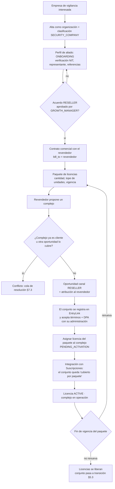
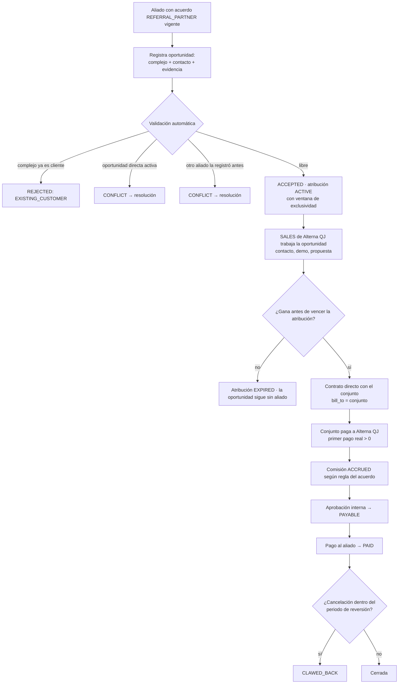
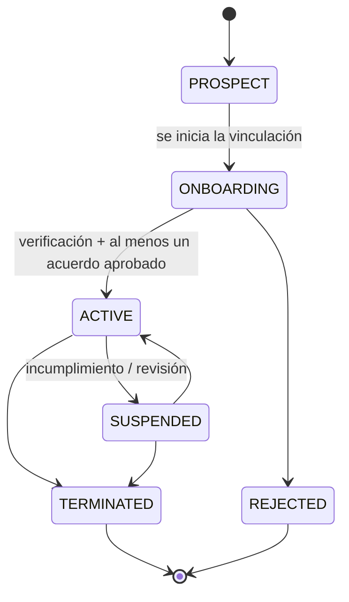
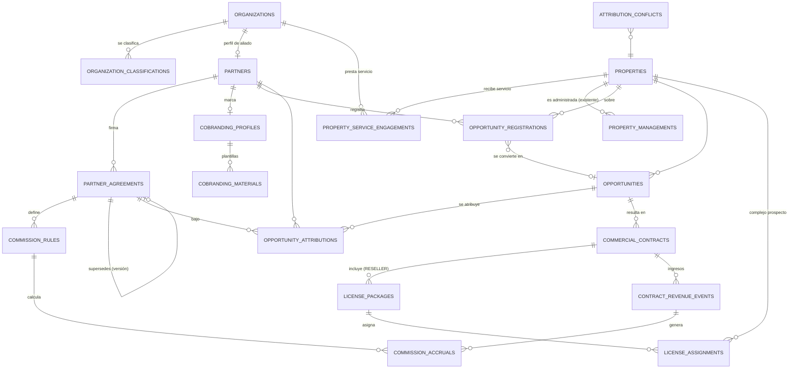
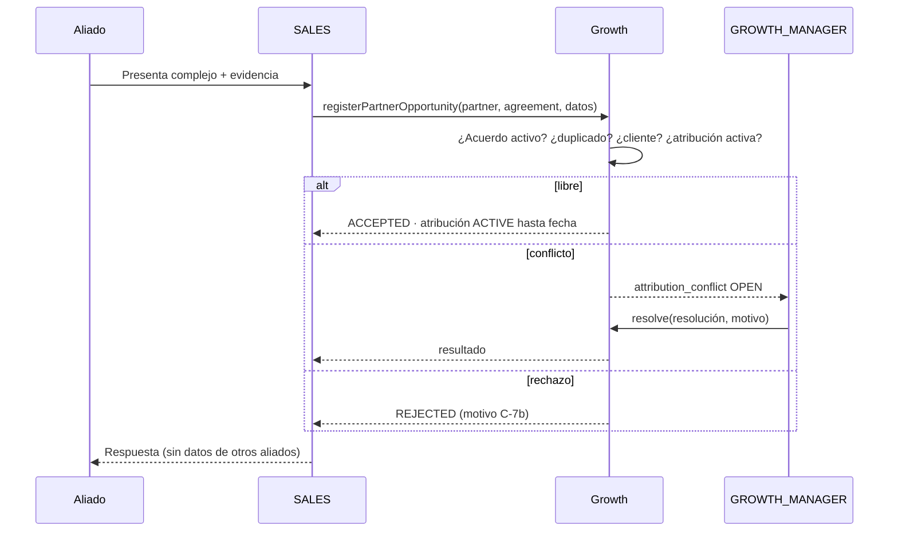

# EntryLink Growth Suite — Partners & Channels (diseño, sin implementar)

_2026-11-05 · Estado: **propuesta para aprobación**. No hay código, migraciones, SQL ni permisos nuevos. Growth sigue como está y `GROWTH_ENABLED` no se toca._

Cómo colaboran comercialmente con Alterna QJ Services SAS las empresas de seguridad y vigilancia privada que quieren llevar EntryLink a los complejos residenciales donde prestan servicio. Hay **dos modalidades independientes**: **RESELLER** (revendedor) y **REFERRAL_PARTNER** (referenciador). Además, el **co-branding** es una configuración aparte, que no depende de la modalidad.

Encaja en la arquitectura actual: monolito modular, esquema `growth` propio, sin FK hacia tablas operativas, actividad append-only, evidencias, fuentes y la regla de que activar la suite no activa permisos (`docs/growth/ACTIVATION.md`).

---

## 0. Principios del diseño

1. **Cinco dimensiones separadas.** Ninguna se deduce de otra:

   | # | Dimensión | Pregunta que responde | Dónde vive |
   |---|---|---|---|
   | 1 | Clasificación de la empresa | ¿Qué *es* la empresa? (vigilancia, administradora, aseo…) | `organization_classifications` |
   | 2 | Función frente al complejo | ¿Qué *hace* en ese complejo? (presta vigilancia, administra…) | `property_service_engagements` (nueva) y `property_managements` (existente) |
   | 3 | Modalidad con Alterna QJ | ¿Cómo *colabora* comercialmente? (RESELLER / REFERRAL_PARTNER) | `partner_agreements.modality` |
   | 4 | Relación contractual y financiera | ¿Quién *contrata y paga* a quién? | `commercial_contracts`, `license_packages`, `commission_accruals` |
   | 5 | Atribución | ¿A quién se le *reconoce* la oportunidad? | `opportunity_attributions` |

2. **La modalidad no es de la empresa.** Va en el acuerdo, y la oportunidad la hereda del acuerdo. Una misma empresa puede tener a la vez un acuerdo RESELLER y otro REFERRAL_PARTNER, y usar cada uno en negocios distintos.
3. **Ser aliado no da acceso a nada operativo.** Ni a residentes, ni a finanzas del conjunto, ni a visitas, paquetes o PQRF. Tampoco da permisos de plataforma.
4. **El co-branding no es white-label.** Es autorización de uso de marca en material comercial. No cambia la web, la app de residentes ni la de portería.
5. **Las licencias compradas no son complejos activos.** Se cuentan por separado: compradas, asignadas y en operación.
6. **El aislamiento se mantiene.** Growth guarda ids lógicos de `public.residential_complexes` (sin FK), como ya define la conversión en el diseño base (§4). Lo operativo (suscripción y cobro del conjunto) se integra por un punto explícito, nunca leyendo tablas operativas desde Growth.

---

## 1. Modelo funcional

### 1.1 Actores (no confundirlos)

| Actor | Qué es | Ejemplo | ¿Acceso a datos del conjunto? |
|---|---|---|---|
| **Cliente comercial** | Quien firma con Alterna QJ y le paga | El revendedor (RESELLER) o el propio conjunto (venta directa o referida) | Solo a lo que diga su contrato; nunca por defecto |
| **Complejo beneficiario** | La copropiedad donde funciona EntryLink | Conjunto «Los Pinos» | Es dueño de sus datos (responsable del tratamiento) |
| **Administrador de la copropiedad** | Representante legal o administración del conjunto | Administradora PH o administrador independiente | Sí, como hoy (`COMPLEX_ROL`), por su vínculo operativo, no por Growth |
| **Empresa de vigilancia** | Presta seguridad al conjunto | «Seguridad Andina Ltda.» | Solo la operación de portería que el conjunto le habilite (como hoy, `SECURITY_ROL`), nunca por ser aliado |
| **Residentes** | Usuarios finales | — | Sus propios datos |
| **Soporte y operación (Alterna QJ)** | Equipo interno | SUPER_ADMIN, soporte | Según su rol actual, con auditoría |
| **Equipo comercial (Alterna QJ)** | Usuarios de Growth | GROWTH_MANAGER, SALES | Solo el esquema `growth` |

> Una empresa de vigilancia puede ser a la vez proveedora de seguridad de un conjunto (dimensión 2) y revendedora de licencias para ese mismo conjunto (dimensiones 3 y 4). El permiso operativo de portería sale del conjunto y la condición de revendedor sale del acuerdo con Alterna QJ. Ninguno de los dos implica el otro.

### 1.2 RESELLER — Revendedor

- Alterna QJ **le factura al revendedor**, que es el cliente comercial de las licencias que compra.
- El revendedor ofrece EntryLink a los complejos donde presta servicio: como valor agregado del contrato de vigilancia o como componente que se cobra aparte. **El precio que le cobra al conjunto es asunto suyo** (decisión pendiente P-04: si Alterna QJ fija un precio mínimo o máximo).
- Compra un **paquete de licencias** con cantidad, límites, vigencia y renovación. Cada licencia se **asigna** a un complejo concreto, y queda registrado cuál la usa.
- **No administra** el conjunto ni ve los datos de sus residentes. El conjunto se registra en EntryLink como cualquier otro y su administración acepta los términos y el DPA.
- Puede usar co-branding si tiene un perfil aprobado y vigente.

### 1.3 REFERRAL_PARTNER — Referenciador

- El aliado **registra la oportunidad**: presenta EntryLink al conjunto o le pasa el contacto a Alterna QJ.
- **Alterna QJ hace la venta** directamente. El conjunto **contrata, recibe la factura y paga a Alterna QJ**.
- El aliado puede recibir una **comisión o incentivo** según su acuerdo, si la atribución está vigente y se cumplen las condiciones (§5.4).
- No compra, no revende y no fija precios.

### 1.4 Venta directa

Sin aliado. Sigue existiendo y es la referencia para comparar canales. Si después aparece un aliado, solo se le atribuye la oportunidad si la resolución de conflictos (§7.3) se lo concede.

### 1.5 Co-branding

Es un perfil por aliado, independiente de la modalidad:
- logotipos y paleta del aliado, junto con la identidad de EntryLink;
- plantillas autorizadas (presentación, propuesta, volante, correo);
- **vigencia y autorización expresa de uso de marca, en las dos direcciones**: el aliado autoriza su marca y Alterna QJ autoriza la de EntryLink, cada una con su documento de soporte.

Solo se aplica al **material comercial** que genera Growth (propuestas y presentaciones). White-label queda fuera de alcance; si algún día se quiere, es otro proyecto con su propia aprobación.

### 1.6 Relación con lo que ya existe

| Existente | Cómo se relaciona |
|---|---|
| `growth.organizations` | El aliado **es** una organización; `partners` es su perfil de aliado (1 a 0..1) |
| `growth.properties` | El complejo prospecto; las oportunidades y las atribuciones apuntan aquí |
| `growth.property_managements` | Sigue siendo **solo la administración** del complejo. La vigilancia va en una tabla hermana nueva |
| `growth.duplicate_candidates` / fusión | Se reutiliza para detectar que dos registros de oportunidad son el mismo complejo |
| `growth.activity_events` (append-only) | Historial de cada cambio de aliado, acuerdo, licencia, atribución y comisión |
| `growth.evidences` / `data_sources` | Soporte de la vigilancia («presta servicio en…»), de los contratos firmados y de las autorizaciones de marca |
| Código de recomendación (`public`, cortesía REFERRAL) | **No es lo mismo.** Es un premio entre conjuntos, en días de cortesía. La comisión de un REFERRAL_PARTNER es dinero para una empresa. No se mezclan los registros, aunque los reportes los puedan mostrar juntos |

---

## 2. Diagramas de proceso

### 2.1 RESELLER

### 2.2 REFERRAL_PARTNER

### 2.3 Ciclo de vida del aliado

---

## 3. Modelo entidad-relación propuesto

Todo en el esquema `growth`, con las convenciones de siempre: UUID, auditoría de quién y cuándo creó o modificó, normalización en hooks, sin FK hacia `public` salvo `users` (igual que hoy). Las referencias a conjuntos reales son `uuid` lógicos.

### 3.1 Tablas

| Tabla | Campos clave | Notas |
|---|---|---|
| `organization_classifications` | `organization_id`, `classification` (cat. C-1), `is_primary`, `valid_from/to`, `source_id`, `evidence_id?` | Una empresa puede tener varias clasificaciones. Reemplaza cualquier tentación de poner un `kind` único |
| `property_service_engagements` | `property_id`, `organization_id`, `service` (C-2), `status` (CURRENT/PAST/UNCONFIRMED), `started_on/ended_on`, `source_id` | Hermana de `property_managements`. Dice qué empresa **presta qué servicio** en qué complejo. No da ningún acceso |
| `partners` | `organization_id` (único), `status` (C-3), `owner_user_id` (SALES responsable), `verified_at/by`, `tax_profile jsonb` (régimen, retenciones), `payout_profile_ref` | Perfil de aliado. Los datos bancarios **no** se guardan aquí (P-09) |
| `partner_agreements` | `partner_id`, `modality` (RESELLER/REFERRAL_PARTNER), `version`, `supersedes_id?`, `status` (C-4), `valid_from/to`, `territory jsonb?`, `terms_summary`, `signed_document_r2_key`, `approved_by/at` | **Inmutable** tras APPROVED: los cambios crean una versión nueva. Puede haber varios activos por aliado si su modalidad difiere |
| `commission_rules` | `agreement_id`, `basis` (C-8), `rate_bps` o `amount`, `currency`, `duration_months`, `clawback_days`, `min_payment_cents`, `caps jsonb` | Solo aplica a REFERRAL_PARTNER (y a un margen RESELLER, si se aprueba P-05) |
| `cobranding_profiles` | `partner_id`, `status` (C-11), `valid_from/to`, `partner_logo_r2_key`, `palette jsonb`, `partner_authorization_r2_key`, `entrylink_authorization_r2_key`, `allowed_uses` (C-12) | Archivos privados en R2. Sin vigencia y sin las dos autorizaciones no se pasa a APPROVED |
| `cobranding_materials` | `profile_id`, `kind` (C-12), `template_version`, `status`, `approved_by/at` | Plantillas aprobadas, una por versión |
| `opportunities` | `property_id`, `channel` (C-5: DIRECT/REFERRAL/RESELLER), `stage` (C-6), `owner_user_id`, `expected_units`, `expected_mrr_cents`, `lost_reason?`, `converted_complex_id?` (lógico) | Es el CRM del roadmap (diseño base §4). El canal es **una sola** decisión por oportunidad |
| `opportunity_registrations` | `partner_id`, `agreement_id`, `property_id?`, `submitted_property jsonb` (lo que mandó el aliado), `status` (C-7), `registered_at`, `decision_reason`, `opportunity_id?` | Lo que el aliado presenta. Se valida antes de crear o atar la oportunidad |
| `opportunity_attributions` | `opportunity_id`, `partner_id`, `agreement_id`, `type` (REFERRAL/RESELLER), `status` (C-9), `valid_from`, `valid_until`, `extended_once` | **Máximo una ACTIVE por oportunidad** (índice único parcial) |
| `attribution_conflicts` | `property_id`, `registration_ids uuid[]`, `opportunity_id?`, `status` (OPEN/RESOLVED), `resolution` (C-10), `resolved_by/at`, `reason` | Cola de resolución manual |
| `commercial_contracts` | `opportunity_id?`, `customer_type` (PARTNER/PROPERTY), `customer_organization_id?`, `customer_property_id?`, `bill_to` (PARTNER/COMPLEX), `status` (C-13), `start_on/end_on`, `renewal_of_id?`, `cancelled_at/reason`, `document_r2_key` | El hecho contractual. RESELLER: cliente = aliado. REFERRAL y DIRECT: cliente = complejo |
| `license_packages` | `contract_id`, `partner_id`, `quantity`, `unit_cap_per_license?`, `valid_from/to`, `status` (C-14), `renewal_of_id?` | Lo que compró el revendedor |
| `license_assignments` | `package_id`, `property_id`, `complex_id?` (lógico), `status` (C-15), `assigned_at`, `activated_at?`, `released_at?`, `release_reason?` | Índice único parcial: una asignación vigente por complejo. Las asignaciones vigentes de un paquete ≤ `quantity` (trigger) |
| `contract_revenue_events` | `contract_id`, `period`, `amount_cents`, `currency`, `kind` (INVOICED/PAID/CREDIT_NOTE/REFUND), `external_ref` | **Copia mínima** que llega desde Suscripciones por el punto de integración. Growth no lee los pagos operativos |
| `commission_accruals` | `rule_id`, `attribution_id`, `revenue_event_id`, `amount_cents`, `status` (C-16), `approved_by/at`, `paid_at`, `payout_ref`, `clawback_of_id?` | Append-only en lo económico: una reversión es otra fila |

**Historial:** no se crea una tabla de historial por entidad. Cada transición escribe en `growth.activity_events`, con nuevos `GrowthEntityType` (`PARTNER`, `PARTNER_AGREEMENT`, `OPPORTUNITY`, `OPPORTUNITY_REGISTRATION`, `ATTRIBUTION`, `CONTRACT`, `LICENSE_PACKAGE`, `LICENSE_ASSIGNMENT`, `COMMISSION`, `COBRANDING_PROFILE`). Los acuerdos, además, se versionan con `supersedes_id`.

### 3.2 Punto de integración con lo operativo (decisión P-01)

Growth no toca `public.*`. Hay dos mensajes, por eventos internos o por un servicio de fachada:

1. **Growth → Suscripciones:** «el complejo X queda cubierto por la licencia Y del paquete Z, con vigencia hasta W». Suscripciones decide cómo lo representa (por ejemplo, un plan «cubierto por canal» sin cobro al conjunto).
2. **Suscripciones → Growth:** eventos de facturación y pago del contrato (para `contract_revenue_events`) y altas y bajas del conjunto (para saber si la licencia está *en operación*). Solo ids, montos y fechas: nada de residentes.

Esto requiere un cambio en el módulo de Suscripciones, que no es parte de Growth y va en su propio PR con aprobación aparte.

---

## 4. Catálogos y estados

| Id | Catálogo | Valores |
|---|---|---|
| C-1 | Clasificación de empresa | `ADMIN_COMPANY`, `INDEPENDENT_ADMIN`, `SECURITY_COMPANY`, `CLEANING_COMPANY`, `FACILITY_SERVICES`, `TECH_INTEGRATOR`, `OTHER` |
| C-2 | Servicio frente al complejo | `SECURITY_GUARDING`, `ELECTRONIC_SECURITY`, `CLEANING`, `MAINTENANCE`, `OTHER` (la administración sigue en `property_managements`) |
| C-3 | Estado del aliado | `PROSPECT`, `ONBOARDING`, `ACTIVE`, `SUSPENDED`, `TERMINATED`, `REJECTED` |
| C-4 | Estado del acuerdo | `DRAFT`, `PENDING_APPROVAL`, `APPROVED`, `ACTIVE`, `EXPIRED`, `SUPERSEDED`, `TERMINATED` |
| C-5 | Canal de la oportunidad | `DIRECT`, `REFERRAL`, `RESELLER` |
| C-6 | Etapa de la oportunidad | `NEW`, `CONTACTED`, `MEETING`, `DEMO`, `PROPOSAL`, `PILOT`, `WON`, `LOST` (ya en el diseño base) |
| C-7 | Estado del registro | `SUBMITTED`, `ACCEPTED`, `REJECTED`, `CONFLICT`, `EXPIRED`, `WITHDRAWN` |
| C-7b | Motivo de rechazo | `EXISTING_CUSTOMER`, `ACTIVE_DIRECT_OPPORTUNITY`, `REGISTERED_BY_OTHER_PARTNER`, `AGREEMENT_NOT_ACTIVE`, `INSUFFICIENT_EVIDENCE`, `OUT_OF_TERRITORY`, `DUPLICATE` |
| C-8 | Base de la comisión | `PERCENT_FIRST_YEAR`, `PERCENT_RECURRING`, `FLAT_PER_CONTRACT`, `FLAT_PER_UNIT` |
| C-9 | Estado de la atribución | `ACTIVE`, `EXPIRED`, `REVOKED`, `CONSUMED` (se convirtió en contrato) |
| C-10 | Resolución de conflicto | `FIRST_REGISTRATION_WINS`, `ASSIGNED_TO_PARTNER`, `KEPT_DIRECT`, `SPLIT_APPROVED` (solo si P-07 lo permite), `REJECTED_ALL` |
| C-11 | Estado del co-branding | `DRAFT`, `PENDING_APPROVAL`, `APPROVED`, `EXPIRED`, `REVOKED` |
| C-12 | Usos y materiales | `PRESENTATION`, `PROPOSAL`, `FLYER`, `EMAIL_TEMPLATE`, `EVENT_MATERIAL` |
| C-13 | Estado del contrato | `DRAFT`, `SIGNED`, `ACTIVE`, `RENEWED`, `CANCELLED`, `EXPIRED` |
| C-14 | Estado del paquete | `PENDING_PAYMENT`, `ACTIVE`, `EXPIRING` (≤ 30 días), `EXPIRED`, `RENEWED`, `CANCELLED` |
| C-15 | Estado de la asignación | `RESERVED`, `PENDING_ACTIVATION`, `ACTIVE`, `SUSPENDED`, `RELEASED` |
| C-16 | Estado de la comisión | `ACCRUED`, `APPROVED`, `PAYABLE`, `PAID`, `CLAWED_BACK`, `VOID` |

Los catálogos van como `varchar` + `CHECK`, igual que el resto de Growth: no se usan enums nativos.

---

## 5. Reglas de negocio y validaciones

### 5.1 Aliados y acuerdos
- R-01: un aliado necesita una organización **validada** (`validation_status = VALIDATED`) con NIT.
- R-02: no se aprueba un acuerdo sin documento firmado, vigencia (`valid_to` obligatorio) y aprobación de alguien con `APPROVE_GROWTH_PARTNER_AGREEMENTS`. Quien lo redacta no lo puede aprobar (cuatro ojos).
- R-03: un acuerdo aprobado es inmutable. Cambiar condiciones = versión nueva (`supersedes_id`). Las atribuciones y comisiones ya generadas conservan la versión con la que nacieron.
- R-04: un aliado puede tener a la vez un acuerdo activo de cada modalidad, pero no dos activos de la misma modalidad con vigencias que se crucen.
- R-05: si se suspende un aliado, se congelan sus atribuciones (no vencen ni generan comisión) y no puede registrar oportunidades ni asignar licencias. Lo ya pagado no se toca.

### 5.2 Registro y atribución
- R-10: el registro exige un acuerdo activo de la modalidad que corresponde y datos mínimos del complejo: nombre, dirección o NIT, y evidencia de la relación (por ejemplo, que presta la vigilancia, o una carta de interés).
- R-11: al registrar se busca el complejo con el motor de duplicados existente (clave normalizada + similitud). Si hay coincidencia, el registro se ata a la `property` existente; nunca se crea una segunda.
- R-12: **cliente existente.** Si el complejo ya tiene un contrato activo o es un conjunto convertido, el registro se rechaza con `EXISTING_CUSTOMER`. Una venta adicional (más unidades, módulos) a un cliente existente no genera atribución, salvo que lo diga P-08.
- R-13: **primera llegada.** Gana el primer registro válido (`registered_at` del servidor). Los siguientes sobre el mismo complejo, mientras haya una atribución activa, quedan `REJECTED (REGISTERED_BY_OTHER_PARTNER)`. Al aliado se le informa que el complejo ya está registrado, sin revelar quién lo registró.
- R-14: **oportunidad directa activa.** Si Alterna QJ ya trabajaba el complejo (actividad en los últimos N días, P-06), el registro va a `CONFLICT` y lo resuelve un GROWTH_MANAGER, que deja el motivo por escrito.
- R-15: **ventana de exclusividad.** La atribución dura N días (propuesta: 90) desde su aceptación. Se puede extender **una vez** con evidencia de avance. Al vencer pasa a `EXPIRED` y la oportunidad sigue como DIRECT.
- R-16: una oportunidad tiene **un solo canal** y **máximo una atribución activa**. Un mismo aliado no puede ser RESELLER y REFERRAL del mismo complejo al mismo tiempo.
- R-17: cambiar el canal de una oportunidad ya atribuida (por ejemplo, de REFERRAL a RESELLER porque el aliado decidió comprar licencias) revoca la atribución anterior y crea otra con el acuerdo nuevo. Queda en el historial.

### 5.3 Licencias (RESELLER)
- R-20: las asignaciones vigentes (`RESERVED`, `PENDING_ACTIVATION`, `ACTIVE`, `SUSPENDED`) de un paquete nunca superan `quantity`. Lo hace cumplir un trigger, no solo el servicio.
- R-21: un complejo tiene como máximo **una** licencia vigente, de cualquier paquete.
- R-22: si `unit_cap_per_license` existe, el conjunto no puede declarar más unidades que el tope (se cruza con las unidades declaradas, igual que el piloto). Si las supera, se avisa y se requiere un ajuste comercial.
- R-23: una licencia pasa a `ACTIVE` solo cuando Suscripciones confirma que el conjunto está registrado, con DPA aceptado y cubierto. Antes de eso, `PENDING_ACTIVATION` no cuenta como «complejo activo».
- R-24: si el paquete vence sin renovar, las asignaciones pasan a `RELEASED (PACKAGE_EXPIRED)` y Growth le avisa a Suscripciones. **El conjunto no se apaga de inmediato:** entra en transición, con un plazo de gracia y la oferta de pasar a contrato directo (P-10).
- R-25: liberar una licencia la devuelve al cupo del paquete. Se registra quién la liberó y por qué.

### 5.4 Comisiones (REFERRAL_PARTNER)
- R-30: solo nace una comisión si (a) la atribución estaba `ACTIVE` al firmar el contrato, (b) hay un **pago real mayor que cero** (la misma lección del código de recomendación: un pago en $0 no premia), y (c) el acuerdo y la regla estaban vigentes al firmar.
- R-31: la comisión se calcula con la regla de la **versión del acuerdo** de la atribución, no con la vigente hoy.
- R-32: si el contrato se cancela o se reembolsa dentro de `clawback_days`, se crea una fila `CLAWED_BACK` que compensa. No se borra ni se edita la original.
- R-33: `ACCRUED → APPROVED` exige `APPROVE_GROWTH_COMMISSIONS`, y quien aprueba no puede ser el SALES dueño de la oportunidad. `PAYABLE → PAID` exige una referencia de pago externa.
- R-34: la comisión se conoce solo dentro de Alterna QJ y con el aliado. La política de **transparencia frente al conjunto** queda pendiente (P-11).

### 5.5 Co-branding
- R-40: un material co-brandeado se genera solo con un perfil `APPROVED`, vigente y con el uso permitido.
- R-41: al vencer o revocarse el perfil, los materiales nuevos salen solo con la marca EntryLink. Lo ya entregado queda en el historial con la versión que se usó.
- R-42: nada del perfil llega a la web operativa, a RemoteLink ni a EntryLinkApp.

---

## 6. Matriz de permisos y responsabilidades

Permisos **nuevos y propuestos**, que nacen **inactivos y sin rol**, igual que los de 1E (`manualActivation`, `ACTIVATION.md` §13). Ninguno se asigna en una migración.

| Permiso propuesto | Nivel | Requiere |
|---|---|---|
| `VIEW_GROWTH_PARTNERS` | LOW | VIEW_GROWTH_PROSPECTS |
| `MANAGE_GROWTH_PARTNERS` | MEDIUM | VIEW_GROWTH_PARTNERS |
| `APPROVE_GROWTH_PARTNER_AGREEMENTS` | CRITICAL | MANAGE_GROWTH_PARTNERS |
| `REGISTER_GROWTH_PARTNER_OPPORTUNITIES` | MEDIUM | VIEW_GROWTH_PARTNERS |
| `RESOLVE_GROWTH_ATTRIBUTION` | HIGH | MANAGE_GROWTH_PIPELINE |
| `MANAGE_GROWTH_LICENSES` | HIGH | MANAGE_GROWTH_PARTNERS |
| `VIEW_GROWTH_COMMISSIONS` | HIGH | VIEW_GROWTH_PARTNERS |
| `APPROVE_GROWTH_COMMISSIONS` | CRITICAL | VIEW_GROWTH_COMMISSIONS |
| `MANAGE_GROWTH_COBRANDING` | MEDIUM | MANAGE_GROWTH_PARTNERS |
| `VIEW_GROWTH_CHANNEL_ANALYTICS` | LOW | VIEW_GROWTH_ANALYTICS |

Asignación propuesta (V = ver · G = gestionar · A = aprobar · — = nada):

| Capacidad | SUPER_ADMIN | GROWTH_MANAGER | SALES | GROWTH_RESEARCHER | COMPLIANCE_OFFICER | Roles de conjunto (COMPLEX, SECURITY, RESIDENT…) |
|---|---|---|---|---|---|---|
| Aliados (perfil) | G | G | V (los suyos) | V | V | — |
| Acuerdos | A | A | V | — | V | — |
| Registro de oportunidades | G | G | G (a nombre del aliado) | — | — | — |
| Resolver conflictos de atribución | A | A | — | — | V | — |
| Licencias y asignaciones | G | G | V | — | V | — |
| Comisiones | A | V | V (las de sus oportunidades) | — | V | — |
| Co-branding | A | G | V | — | V | — |
| Reportes de canal | V | V | V (propios) | — | V | — |

- **Los aliados no reciben ningún rol de plataforma** por ser aliados. En esta propuesta tampoco hay portal de aliados: registran sus oportunidades por medio de SALES (formulario o correo con evidencia). Un portal es una decisión aparte (P-02) y, si se aprueba, vendría con un rol propio (`PARTNER_PORTAL_ROL`) que solo ve **sus** registros, atribuciones, licencias y comisiones, nunca datos del conjunto.
- Un revendedor que además es la vigilancia de un conjunto sigue operando la portería con lo que el conjunto le habilite. Esa ruta no cambia y no se cruza con Growth.
- `COMPILANCE_OFFICER_ROL` ve todo en solo lectura (acuerdos, autorizaciones de marca, comisiones), por auditoría.

**Responsabilidades (RACI resumido):**

| Proceso | Responsable | Aprueba | Consultado | Informado |
|---|---|---|---|---|
| Vincular aliado | SALES | GROWTH_MANAGER | Cumplimiento | SUPER_ADMIN |
| Acuerdo y comisión | GROWTH_MANAGER | SUPER_ADMIN | Jurídico, contabilidad | Cumplimiento |
| Atribución en conflicto | GROWTH_MANAGER | — | SALES involucrados | Aliado(s) |
| Licencias | SALES | GROWTH_MANAGER | Soporte | Aliado |
| Pago de comisiones | Contabilidad (externa a la plataforma) | SUPER_ADMIN | GROWTH_MANAGER | Aliado |
| Marca compartida | GROWTH_MANAGER | SUPER_ADMIN | Jurídico | Aliado |

---

## 7. CRM y atribución

### 7.1 Qué se puede identificar en cada oportunidad
Canal (DIRECT/REFERRAL/RESELLER) · aliado y acuerdo (versión) · complejo (`property_id`, y `converted_complex_id` al convertir) · etapa · dueño en SALES · contrato resultante · ingresos atribuibles (de `contract_revenue_events`) · renovaciones y cancelaciones (`renewal_of_id`, `cancelled_at`) · comisión o margen aplicable (`commission_accruals` / P-05).

### 7.2 Flujo de registro

### 7.3 Prioridad y resolución de conflictos (en orden)
1. Si el complejo es **cliente existente**, se rechaza (R-12).
2. Si hay **atribución activa** de otro aliado, se rechaza, salvo que esté por vencer y lo decida un GROWTH_MANAGER (R-13).
3. Si hay una **oportunidad directa con actividad reciente**, va a conflicto y por defecto se queda `KEPT_DIRECT`. Se concede al aliado solo si aporta algo que Alterna QJ no tenía (contacto con quien decide, una reunión agendada).
4. Si llegan **dos registros casi simultáneos** (dentro de la misma hora), van a conflicto y el criterio es la mejor evidencia (por ejemplo, contrato vigente de vigilancia con el complejo).
5. No se reparte comisión entre aliados (`SPLIT_APPROVED`), salvo que P-07 lo apruebe.

Toda resolución deja motivo, quién resolvió y cuándo, en `attribution_conflicts` y en `activity_events`.

---

## 8. Interfaz de usuario (entrylink-web `/growth`, dirección visual «Troncal»)

| Ruta | Contenido |
|---|---|
| `/growth/aliados` | Lista con filtros por estado, modalidad (por acuerdo), clasificación y responsable. Indicadores por fila: acuerdos activos, licencias usadas/compradas, oportunidades abiertas |
| `/growth/aliados/[id]` | Pestañas: **Perfil** (organización, clasificaciones, verificación) · **Acuerdos** (versiones, la vigente destacada, con un comparador entre versiones) · **Oportunidades** (registros y atribuciones con su vencimiento) · **Licencias** (paquetes, barra comprado/asignado/en operación, asignar y liberar) · **Comisiones** (por estado, con totales) · **Marca compartida** (perfil, autorizaciones, vencimiento, plantillas) · **Historial** (actividad) |
| `/growth/registros` | Bandeja de registros SUBMITTED y CONFLICT; el detalle muestra coincidencias encontradas y los botones de resolución (con motivo obligatorio) |
| `/growth/oportunidades` | El CRM del roadmap, con una columna de canal y un distintivo del aliado |
| `/growth/comisiones` | Liquidación: ACCRUED → APPROVED → PAYABLE → PAID, aprobación por lote con doble control |
| `/growth/canales` | Reportes del §9 |

Detalles de interacción:
- La modalidad se elige **al crear el acuerdo**, nunca en el perfil del aliado.
- Las vigencias que vencen en 30 días o menos se marcan (acuerdos, atribuciones, paquetes y co-branding).
- Al asignar una licencia se busca el complejo; si no existe, se ofrece crearlo como `property` (con validación), nunca escribir en `public`.
- El detalle del aliado **no muestra** datos de residentes ni del conjunto: solo el estado comercial (licencia activa o no, fecha de activación).

---

## 9. Reportes y métricas

Las métricas salen de vistas en el esquema `growth`. Al principio son vistas simples; si crecen, pasan a vistas materializadas con un cron, como en el diseño base.

| Métrica | Definición exacta | Cuidado |
|---|---|---|
| Ventas por revendedor | Contratos `SIGNED+` con `customer_type = PARTNER`, por aliado y periodo; valor = monto del contrato | Es venta **de licencias**, no complejos |
| Ventas por referenciador | Contratos con atribución `CONSUMED` de tipo REFERRAL, por aliado | — |
| Licencias compradas / asignadas / en operación | `Σ quantity` de paquetes vigentes · asignaciones `RESERVED+PENDING+ACTIVE+SUSPENDED` · asignaciones `ACTIVE` confirmadas por Suscripciones | Son **tres números distintos**; nunca se muestra uno solo como «complejos» |
| Uso de licencias | en operación / compradas | Alerta si queda por debajo del 50 % a 60 días de vencer |
| Complejos activos por aliado | Complejos distintos con licencia `ACTIVE` (RESELLER) o contrato `ACTIVE` atribuido (REFERRAL) | Se cuenta por complejo, no por contrato |
| Ingresos directos vs. de canal | `Σ contract_revenue_events(PAID)` por canal de la oportunidad de origen | Neto de reembolsos y notas crédito |
| Comisiones pendientes / liquidadas | `Σ` por estado (ACCRUED+APPROVED+PAYABLE vs. PAID − CLAWED_BACK) | En la moneda del acuerdo |
| Renovación, cancelación y retención por canal | Cohortes por mes de inicio del contrato; renovación = `RENEWED / vencidos`; *logo churn* y *revenue churn* | RESELLER: se mide sobre paquetes **y** sobre complejos |
| Conversión de referidas | Registros `ACCEPTED` → oportunidades `WON` dentro de la ventana, y tiempo medio hasta ganar | Las vencidas cuentan como no convertidas |
| Calidad de registros | `ACCEPTED / SUBMITTED` por aliado, y motivos de rechazo | Sirve para detectar registros por volumen sin calidad |

---

## 10. Riesgos, decisiones pendientes y preguntas

### 10.1 Riesgos
| Riesgo | Mitigación |
|---|---|
| **Conflicto de interés:** la vigilancia recomienda un producto por el que cobra comisión, a la copropiedad que le paga | P-11 (transparencia) y revisión jurídica antes de activar REFERRAL |
| El revendedor pide «ver» a los residentes de «sus» conjuntos | Principio 3; el contrato con el revendedor y el DPA del conjunto lo excluyen; ningún rol se crea por modalidad |
| Doble conteo de ingresos (licencia del revendedor + suscripción del conjunto) | Un complejo con licencia vigente no se cobra en Suscripciones (P-01); hay un reporte de cuadre |
| Cuando el revendedor no renueva, los conjuntos quedan sin servicio | Transición (R-24, P-10), con avisos desde 30 días antes |
| Peleas de atribución | Reglas deterministas (§7.3), sello de tiempo del servidor y motivo obligatorio |
| El co-branding se convierte en white-label por la puerta de atrás | R-42 y alcance limitado a material comercial |
| Datos personales de contactos que trae el aliado | Mismas reglas de Growth: base legal, `PENDING_LEGAL_REVIEW` sin contacto, fuente `REFERRAL` y evidencia |
| Tributario (retención en la fuente sobre comisiones, facturación electrónica del aliado) | Contabilidad define el proceso antes de la primera liquidación (P-09) |

### 10.2 Decisiones pendientes (requieren aprobación)
- **P-01** Integración con Suscripciones: ¿cómo se representa un conjunto «cubierto por un paquete»? (plan especial, cortesía, o un nuevo `billing_source = PARTNER`). Es un cambio fuera de Growth.
- **P-02** ¿Habrá portal de aliados (`PARTNER_PORTAL_ROL`) o los aliados trabajan solo por medio de SALES? Recomendación: sin portal en la primera entrega.
- **P-03** Unidad de licencia: ¿por complejo, con tope de unidades, o por unidad residencial? Recomendación: **por complejo, con tope de unidades**, porque coincide con cómo se cotiza hoy.
- **P-04** ¿Alterna QJ fija un precio mínimo o máximo de reventa al conjunto, o es libre?
- **P-05** ¿El revendedor solo tiene descuento sobre la lista (margen implícito) o también comisiones? Recomendación: solo descuento.
- **P-06** Ventana de exclusividad (propuesta: 90 días + una extensión de 30) y «actividad directa reciente» (propuesta: 60 días).
- **P-07** ¿Se permite repartir la comisión entre dos aliados? Recomendación: no.
- **P-08** ¿Las ventas adicionales a clientes existentes generan comisión?
- **P-09** Datos de pago y tributarios de los aliados: ¿dónde viven? Recomendación: fuera de la plataforma (contabilidad) y en Growth solo la referencia.
- **P-10** Transición al vencer un paquete: ¿cuántos días de gracia y con qué condiciones pasa a contrato directo?
- **P-11** ¿Se le informa al conjunto que su vigilancia recibe una comisión? Recomendación: sí, por escrito en la propuesta; pendiente de confirmar con abogado.
- **P-12** Moneda e impuestos: ¿solo COP, con IVA incluido o aparte? (aplica a paquetes y comisiones).

### 10.3 Preguntas para el usuario
1. ¿Hoy ya hay alguna empresa de vigilancia en conversación? Si la hay, ¿en qué modalidad? Sirve para ordenar la primera entrega.
2. ¿Quién paga las comisiones y con qué periodicidad (mensual o trimestral)?
3. ¿El co-branding se necesita en la primera entrega o puede esperar?
4. ¿Las propuestas co-brandeadas se generan en PDF desde Growth, o basta con plantillas descargables?

---

## 11. Entregas sugeridas (no se inicia ninguna sin aprobación)

| Entrega | Alcance | Depende de |
|---|---|---|
| PC-0 | Clasificaciones, `property_service_engagements` y aliados (perfil y estados) | Aprobación de este diseño |
| PC-1 | Acuerdos versionados, registro de oportunidades, atribución y conflictos (con el CRM mínimo de `opportunities`) | PC-0, P-06, P-07 |
| PC-2 | Contratos, paquetes y asignaciones de licencias | PC-1, **P-01 y el cambio en Suscripciones**, P-03 |
| PC-3 | Eventos de ingreso y comisiones (devengo, aprobación, reversión) | PC-2, P-09, P-12 |
| PC-4 | Co-branding y plantillas | PC-0, revisión jurídica de marca |
| PC-5 | Reportes de canal | PC-2 y PC-3 |

Cada entrega sigue la regla de siempre: plan → rama → pruebas con Postgres real → PR en borrador → aprobación. Todos los permisos nacen inactivos.
